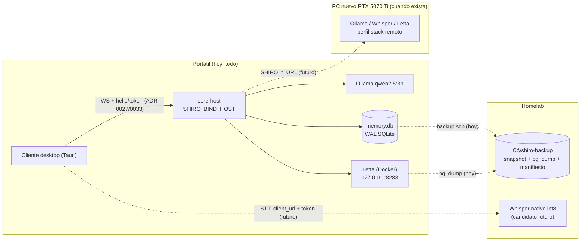

# Plan de mejora y corrección — Proyecto Shiro (2026-11)

> **Fecha:** 2026-11-12 · **Autoría:** Pipe + Claude (revisión multi-agente: 3 planes alternativos, 3 jueces, síntesis y 2 críticos) · **Estado:** Propuesta — pendiente de aprobación. **La Fase 1 quedó aprobada entera el 2026-11-13 y está en ejecución**; las demás fases siguen pendientes de aprobación, fase a fase.
>
> **Alcance de este documento.** Es **solo la propuesta**. Durante la revisión no se ha tocado código ni documentación del repo. **Ningún ítem P-xx se ejecuta hasta que Pipe apruebe su fase**. En la Fase 1, las acciones manuales que el plan le asignaba (borrar ramas remotas muertas, ajustes de GitHub, Docker y digests, pruebas manuales) las hace el agente (§2); en las demás fases, las acciones sobre GitHub (required checks, Environments, secrets, borrado de ramas), sobre ramas y sobre el homelab las confirma Pipe en el momento de hacerlas.
>
> **Cómo se usa.** Acompaña al informe [`docs/revision-estado-2026-11.md`](revision-estado-2026-11.md), que contiene los hallazgos verificados (R-xxx) y los lotes de arreglo (L-TEMA-NN), y a su [anexo](revision-estado-2026-11-anexo.md) con la evidencia de cada hallazgo. Aquí solo se citan por ID. Cada ítem P-xx se convierte en uno o varios **PRs pequeños a `develop`**, con prefijo de commit (`feat:`, `fix:`, `test:`, `docs:`, `refac:`, `chore:`, `ci:`). Un ítem se **tacha** (`~~P-xx~~` y fecha) cuando se fusiona su último PR. Una fase no empieza hasta que se cumple el gate de salida de la anterior.
>
> **Regla única para ADR** (la aplican todos los ítems y los «PR sugerido»):
>
> - Un **ADR nuevo** va en un PR `docs:` propio, fusionado **antes** que el código que lo implementa. Usa `docs/adr/template.md`, se llama `docs/adr/NNNN-titulo-en-kebab-case.md`, lleva su fila en `docs/adr/README.md` y queda con Status `Accepted`.
> - Una **enmienda de un ADR existente** viaja en el **mismo PR que el código** que la cumple.
> - Los cambios que un ADR nuevo provoca en otros ADR (nota de enmienda, `Superseded by`) viajan en el PR de ese ADR nuevo.
>
> Las direcciones de la red local están sustituidas por `IP_PORTATIL`, `IP_HOMELAB`, `IP_LAPTOP_PRESTADA` y `SUBRED_ENLACE`.

---

## 1. Resumen ejecutivo

- **Situación.** Shiro funciona para un usuario y un cliente en localhost (hitos 1-11 hechos), pero cumple menos de lo que dicen sus ADR. ADR 0025 y 0027 están Accepted sin una línea implementada: el bus, `/audio`, Whisper y Letta escuchan en todas las interfaces, sin Origin ni token.
- **Self-dev** puede hacer push de un workflow antes de que Pipe vea el diff, y su denylist se salta en NTFS.
- **Fallos silenciosos.** Los fallos no se ven: el logger imprime los `Error` como `{}`, el transporte descarta mensajes y el health mira «vivo» y no «listo».
- **Memoria sin copia.** La memoria, el único dato irrecuperable, está en un solo disco y sin backup.
- **Proceso desfasado.** El CI solo cubre Ubuntu y no vigila las dependencias (los avisos de `npm audit` pasaron de 10 en julio a 31 hoy sin que nada avisara). La documentación describe un equipo de 2, una RTX 5080 y un `main` estable que no existen.
- **Enfoque del plan.** Pipe trabaja solo, 4-6 h/semana. El plan prioriza la sostenibilidad: una sola fuente de verdad, CI que proteja, fronteras de confianza fijadas por tests antes de delegar, y algo visible en cada fase. Son 5 fases de unas 6 semanas. Cada fase tiene un **núcleo** (lo único que exige su gate, dimensionado para 4 h/semana) y unos **recortables** con destino escrito por si no caben. Total ≈ 174 h, de las que ≈ 129 h son núcleo (detalle en §2).
- **F1 (contención y red cerrada).** Self-dev apagado, suite verde, red en loopback, CI con audit y check obligatorio, docs que dicen la verdad, y conexión visible y audio que no se corta.
- **F2 (datos a salvo y diagnóstico).** Backup al homelab con restauración ensayada, health «listo», PTT fiable, latencia medida, CI en Windows y arranque del diario de uso.
- **F3 (fronteras de agentes).** Suite «contrato de seguridad», self-dev con push tras la aprobación y eval aislado, y modal que muestra lo que se aprueba. Self-dev se reactiva.
- **F4 (turno correcto y topología saliente).** Tool-loop honesto, SDK de Anthropic al día, datos separados de instrucciones y **URLs salientes** (Ollama, Letta, Whisper) por entorno. Cualquier bind distinto de loopback sigue bloqueado hasta que exista el token (F5).
- **F5 (puerta de la estación).** Protocolo multicliente, validación de eventos entrantes, `clientId`, token (ADR 0027) y unicast. Al cerrarla, la estación holográfica o mover un servicio fuera del portátil solo exige variables y token, sin reescribir contratos.

## 2. Decisiones de contexto que fija este plan

| Tema                             | Decisión                                                                                                                                                                                                                                                                                                                                                                                                                                                                                                                                                                                                                                                                                                                                                                                                                                           |
| -------------------------------- | -------------------------------------------------------------------------------------------------------------------------------------------------------------------------------------------------------------------------------------------------------------------------------------------------------------------------------------------------------------------------------------------------------------------------------------------------------------------------------------------------------------------------------------------------------------------------------------------------------------------------------------------------------------------------------------------------------------------------------------------------------------------------------------------------------------------------------------------------- |
| **Capacidad**                    | Pipe trabaja **solo**, 4-6 h/semana. Tarifas, contando el tiempo de revisar a los agentes: S agente ≈ 0,75-1 h · S mixto ≈ 1,5 h · S humano ≈ 2 h · M agente ≈ 2 h · M mixto ≈ 3-4 h · M humano ≈ 5 h · L mixto ≈ 8 h · L humano ≈ 10 h · redactar un ADR nuevo ≈ +2 h · enmienda de un ADR existente ≈ +0,5-1 h. Cada fase tiene un **núcleo** de ≈ 24 h (cabe a 4 h/semana en 6 semanas; F4 y F5 lo superan, ver abajo) y unos **recortables** con destino. **Los gates solo exigen el núcleo**: un recortable que no cabe se mueve a su destino y no rompe ningún gate. Cada gate termina con la línea «horas reales frente a previstas». Quien dibuja el arte del personaje no programa. El compañero ya no está activo: P-03a lo corrige en los documentos. El tiempo de **usar** Shiro (diario, P-21) no se cuenta como horas de desarrollo. |
| **Hardware**                     | Todo corre en el **portátil** (Ryzen 5 4600H, 16 GB, GTX 1650 de 4 GB): core-host, cliente, Docker (Letta y Whisper) y Ollama con qwen2.5:3b. **No se planifica sobre el PC nuevo** (RTX 5070 Ti sin montar ni presupuesto). Solo se deja el perfil «stack remoto» del ADR 0032, que no se puede activar hasta F5.                                                                                                                                                                                                                                                                                                                                                                                                                                                                                                                                 |
| **Homelab**                      | **Solo destino de backup** con restauración ensayada (P-11a). Se deja **abierto el camino** mediante URLs por entorno, bind configurable y token, sin mover ningún servicio en este plan. No se toca nada fuera de su carpeta propia: la carpeta del otro proyecto y el share de ese proyecto son de otro proyecto.                                                                                                                                                                                                                                                                                                                                                                                                                                                                                                                                |
| **Avatar y overlay**             | **Aplazados por Pipe.** La integración de ADR 0028 (chibi por capas, después VRM) y el modo overlay no se programan. Basta con que ningún contrato nuevo les cierre la puerta: ADR 0033 **reserva** el evento de expresión sin decidir quién la calcula, y ADR 0028 se actualiza cuando se retome. Live2D está aparcado: no se invierte en optimizarlo.                                                                                                                                                                                                                                                                                                                                                                                                                                                                                            |
| **Fuente de verdad del roadmap** | **La tabla del README** (Ahora / Siguiente / Ideas). CLAUDE.md es la única fuente de instrucciones para agentes. AGENTS.md pasa a ser un **extracto mínimo y estable** (reglas duras y comandos) generado desde CLAUDE.md por un script y comprobado en `verify` (P-19b), porque Codex y otras herramientas no siguen enlaces. El estado de seguridad es la tabla viva de `docs/security-review-2026-07.md`. Lo fija ADR 0029 (P-03a).                                                                                                                                                                                                                                                                                                                                                                                                             |
| **`main` y releases**            | `develop` es la única rama de integración, con **check de CI obligatorio**. Las versiones son tags `vX.Y.Z` sobre `develop`. `main` deja de prometerse como «estable»: avanza solo al publicar un tag, y lo hace por **fast-forward** hasta ese tag (ADR 0029 y su nota del 2026-11-13). El borrador v0.1.0 **no se publica**: la clave del updater se rota (posible sin release puente porque no hay instalaciones). **No habrá release** hasta pasar el gate de F3 y la **checklist pre-release verificable** de ADR 0029: build del sidecar y de Tauri en CI, tag igual a la versión, tests en verde antes de firmar, P-09 hecho y LICENSE presente (P-20). Esa checklist es la forma de cumplir L-TOOL-10/L-TOOL-11 mientras sigan aparcados.                                                                                                  |
| **Aprobación y fusión**          | **Fase 1 aprobada entera el 2026-11-13.** Como mucho 2 PRs de agente abiertos. Los PRs de la Fase 1 los **fusiona el agente** cuando el CI está en verde y un segundo agente ha revisado el diff: Pipe delegó de forma expresa la revisión previa de cada PR. Las tareas manuales que la Fase 1 le asignaba (borrar ramas remotas muertas, ajustes de GitHub como las alertas de Dependabot y el check obligatorio, arrancar Docker y sacar digests, pruebas manuales de red, del modal y del log) las hace el agente. A Pipe solo se le pide lo que solo él puede hacer: pagar o cambiar de plan, iniciar sesión, crear y pegar claves, escuchar la voz y elegir, y grabar su voz. Para las demás fases no cambia nada: Pipe aprueba cada fase antes de empezarla.                                                                                |
| **Issue tracker**                | **No se adopta.** Seguimiento: las casillas de este plan, la tabla del README y la tabla viva SEC-xx.                                                                                                                                                                                                                                                                                                                                                                                                                                                                                                                                                                                                                                                                                                                                              |
| **Gemini**                       | Como mucho **1-2 lecturas grandes por semana**, opcionales, y solo como segunda opinión de P-05, P-23, P-40 y ADR 0033. La cuota es pequeña y compartida. Ningún gate lo exige y el plan no depende de él.                                                                                                                                                                                                                                                                                                                                                                                                                                                                                                                                                                                                                                         |

### 2.1 Escenarios de capacidad

| Fase                      | Núcleo (lo exige el gate) | Recortables → destino si no caben                                                         | A 4 h/sem              | A 5 h/sem            | A 6 h/sem                            |
| ------------------------- | ------------------------- | ----------------------------------------------------------------------------------------- | ---------------------- | -------------------- | ------------------------------------ |
| F1                        | 24 h                      | P-03b 2 h (→ F2) · P-09 4 h (→ F2/F3; obligatorio antes del primer tag) · P-44 1 h (→ F2) | 6 sem, solo núcleo     | ~6,5 sem, todo       | 5 sem, todo                          |
| F2                        | 24 h                      | P-15b 2 h · P-13 1,5 h · P-11b 1,5 h · P-16b 2,5 h · P-45 1 h (→ F3 o cola P-42)          | 6 sem, solo núcleo     | 6 sem, núcleo + ~6 h | 6 sem, todo                          |
| F3                        | 24 h                      | P-18 2 h · P-20 4 h · P-26b 1 h · P-25b 4,5 h · P-46 1,5 h · P-47 1,5 h (→ F4 o cola)     | 6 sem, solo núcleo     | 6 sem, + P-18 y P-20 | 6 sem, casi todo                     |
| F4                        | 26,5 h                    | P-31b 2 h · P-36 4 h · P-19 4 h · P-31c 4 h · P-48 1 h (→ cola o post-plan)               | ~7 sem, solo núcleo    | 6 sem, + P-31b       | 6 sem, + P-31b, P-36 y parte de P-19 |
| F5                        | 30,5 h                    | —                                                                                         | ~8 sem                 | ~6 sem               | ~5 sem                               |
| **Puerta de la estación** | —                         | —                                                                                         | **semana ~33 (mes 8)** | **semana ~30-31**    | **semana ~28**                       |

- **A 4 h/semana sale del plan** (pasa a la cola P-42 o a post-plan, en este orden de prioridad): P-09 (antes de cualquier tag), P-20, P-13, P-15b, P-11b, P-18, P-26b, P-16b, P-36, P-19, P-31b, P-25b, P-31c y los saltos de tooling P-44 a P-48. P-29 no sale: con un agente cuesta ≈ 1 h y su gate lo exige.
- **Los recortables no retrasan la estación**, porque ningún gate depende de ellos. Lo que la retrasa es que el **núcleo** se pase: cada 4-5 h de exceso es ≈ 1 semana más.
- **Total:** ≈ 174 h (núcleo ≈ 129 h). A 5 h/semana caben ≈ 150 h en 30 semanas; los ≈ 24 h restantes son recortables de F2-F4 que van a la cola.

## 3. Diagnóstico

La revisión es la del informe; aquí va solo la síntesis que justifica el orden.

- **Seguridad y fronteras de confianza (R-001…R-056).** Hay decisiones Accepted sin implementar y sin ningún test que lo detecte: bind y Origin (R-002/R-003/R-004), token (R-005), Whisper sin tope (R-006). Las fronteras se validan comparando texto y no la forma canónica: denylist NTFS (R-025…R-028), allowlist de shell sin ancla final (R-009/R-010/R-029), symlinks en FsScope (R-021). La aprobación humana es la única barrera y le llega información incompleta: preview truncado (R-014/R-015), foco en «Permitir» (R-030), push antes del gate (R-001/R-022). El contenido externo entra en el prompt con autoridad (R-016/R-020). La cadena de suministro no está vigilada (R-007/R-008/R-011). Lotes L-SEG-01…17.
- **Bugs (R-057…R-124).** El patrón dominante es que **los errores no dejan rastro**: R-057 (high), R-068/R-282, R-064/R-071. Los turnos no tienen identidad (R-061, R-093, R-094), el arranque y el apagado no están coordinados (R-059, R-076/R-077) y la memoria tiene dos caminos de escritura (R-072, R-073). Además, el audio se corta al cambiar de pantalla (R-058, high). Lotes L-BUG-01…19.
- **Rendimiento (R-125…R-150).** El turno es secuencial y todo-o-nada, y **nadie lo ha medido** (R-134/R-135), ni tampoco la VRAM de 4 GB (R-131). Hay que medir antes de decidir el streaming (R-126/R-128). Lotes L-PERF-01…11.
- **Arquitectura (R-151…R-187).** El bus está diseñado para un solo cliente (R-151/R-152, high): la estación exige reformar el protocolo, no basta con añadir un `OutputRouter`. La topología está congelada en localhost y en el build (R-181/R-182/R-184). La memoria no tiene versión, retención ni origen (R-156, R-161, R-176). Lotes L-ARQ-01…15.
- **Tests (R-188…R-208).** Los huecos están justo en las fronteras: tool-use (R-188), steps reales de self-dev (R-189), WS `/stt` (R-193). La cobertura no se aplica en `npm test` aunque los umbrales existen en `packages/core/vitest.config.ts` (R-203). Los tests Python están rotos y fuera del CI (R-194/R-207). Lotes L-TEST-01…09.
- **Tooling y CI (R-209…R-238).** El CI valida solo lo fácil y solo en Ubuntu (R-210, R-212). Las versiones no están fijadas: Letta `:latest` (R-213/R-315), Node frente al ABI node22 (R-223), SDK 0.x (R-215). No hay política de ramas escrita (R-217). Lotes L-TOOL-01…11.
- **Documentación (R-239…R-276).** El estado está copiado en 5 documentos que ya divergen (R-240, R-242). ADR 0027 tiene errores de partida: Origin de Tauri (R-250/R-153), MANAGED_KEYS (R-251). Hay config que no hace nada (R-241, R-246). Falta licencia (R-269). Lotes L-DOC-01…10.
- **Producto y roadmap (R-277…R-313).** El primer minuto es frágil y opaco (R-280, R-281, R-282, R-284). La red no está endurecida y el portátil ya tiene una segunda interfaz hacia el homelab (R-277, high). El botón «Permitir» es ilegible en Cyberpunk (R-286). No se puede olvidar (R-283). Lotes L-PROD-01…11.
- **Homelab (R-314…R-339).** La topología está cableada a localhost: la URL de audio (R-314, high), la URL de STT (R-321) y los overrides (R-325). El rol de backup ya decidido no tiene implementación (R-323/R-329/R-330). Lo de correr Whisper nativo es cierto pero prematuro (R-333/R-334/R-339). Lotes L-HOME-01…11.

**Lectura transversal.** Casi todo se arregla con PRs S/M y el riesgo de dependencias en producción es bajo (solo zod es alcanzable). Lo caro (token, protocolo, turnos, streaming) se concentra en los contratos del bus, que la estación va a exigir de todos modos. Nada requiere el PC nuevo.

## 4. Principios del plan

1. **Contener antes de arreglar.** Si una superficie es peligrosa y su arreglo es caro, se apaga hasta que su gate esté verde. Self-dev queda apagado desde la semana 1 (P-01) hasta el gate de F3.
2. **Lo barato de los ADR ya aceptados va antes que lo caro.** Loopback, Origin, topes de Whisper y `approved === true` (ADR 0025/0027, secuencia 2a) se hacen en F1. El token (2b) y el protocolo multicliente, en F5.
3. **Ninguna frontera se da por cerrada sin un test en CI que la fije.** La suite «contrato de seguridad» es la condición para delegar en agentes y en self-dev.
4. **Algo visible en cada fase.** Cada fase incluye al menos un cambio que Pipe nota al usar Shiro, y siempre en el núcleo: conexión visible y audio global (F1), health «listo» y PTT (F2), modal honesto (F3), tool-loop que no miente (F4).
5. **Una sola fuente de verdad por tipo de información.** El resto de documentos enlaza; no copia.
6. **Primero el ADR, luego el código.** Se aplica la regla única de la cabecera: ADR nuevo en PR propio previo; enmienda de ADR existente en el mismo PR que el código. Los números de ADR se asignan por orden real de fase, no por la numeración de los analistas.
7. **Un backup solo cuenta si la restauración se ha ensayado** en un directorio limpio y la fecha del ensayo queda escrita.
8. **Topología por variables, sin mover nada todavía.** Se preparan seams (bind, URLs relativas y por entorno, token), nunca despliegues. Lo aplazado (avatar, overlay, móvil, IoT) recibe notas, no trabajo.
9. **Un gate solo exige núcleo.** Si un ítem es recortable, ninguna condición de gate depende de él; su condición se mueve al gate o a la checklist donde aterriza.

## 5. Fases

Leyenda: **effort** S/M/L. **Quién:** `agente` (Claude escribe y Pipe revisa), `mixto` (Pipe decide o prueba a mano y el agente escribe), `humano` (Pipe), `selfdev` (el self-dev de Shiro, con revisión de Pipe). **h** = horas humanas estimadas. **Bloque:** `núcleo` (lo exige el gate) o `recortable → destino`. **En la Fase 1** (decisión del 2026-11-13, §2), «Pipe revisa» lo sustituye la revisión del diff por un segundo agente, el agente fusiona con el CI en verde, y las pruebas manuales y los ajustes que las filas atribuyen a Pipe los hace el agente, salvo los que necesitan su oído, su voz, su sesión, sus claves o un pago.

### Fase 1 — Contención, una sola verdad y red cerrada (semanas 1-6)

**Objetivo.** Cerrar lo ya expuesto (red, self-dev) y dejar la suite en verde. Que `develop` exija un check en verde, que los documentos digan la verdad (Pipe solo) y que Pipe note ya dos mejoras: ver si Shiro está conectada y que el audio no se corte.

**Gate de salida** (todo verificable; si falla uno, no empieza F2):

1. `npm run verify` en verde en Windows: **0 fallos y 0 tests omitidos sin motivo anotado** (dato de partida: 636 pasan, 1 omitido, 1 falla por timeout en shell-tool). CI en verde en `develop`, con `scripts/audit-prod.mjs` (excepción fechada solo para form-data) y el check marcado como _required_ en GitHub.
2. Con el stack levantado, `netstat -ano` en el portátil muestra **9876 (core-host, bus y `/audio`), 8765 (Whisper) y 8283 (Letta)** escuchando **solo en 127.0.0.1**. El Postgres de Letta no se publica en `docker-compose.yml`, así que no entra en la comprobación. Desde el homelab, `Test-NetConnection IP_PORTATIL -Port 9876` falla.
3. Tests en CI: un Origin ajeno da 403/close, `address()` es 127.0.0.1 por defecto, `approved:"false"` no aprueba, y Whisper corta un stream por encima del tope (job pytest mínimo de P-06b).
4. Self-dev desactivado por defecto (`selfdev.enabled: false`), con un test que lo comprueba.
5. Test con transport falso: al cerrarse el socket, el estado pasa a desconectado en ≤ 3 s y el input se deshabilita. Test: desmontar ConversationScreen no corta el audio. Prueba manual de las dos cosas (la hace el agente).
6. ADR 0029 Accepted y en el índice. README, CLAUDE.md y AGENTS.md dicen «1 persona» y GTX 1650 y no duplican el roadmap.
7. Horas reales frente a previstas anotadas al cerrar la fase.

_(La condición «`release.yml` con Actions por SHA y clave nueva» ya no está en este gate: P-09 es recortable y su condición pasa a la checklist pre-release de ADR 0029, «antes del primer tag».)_

| ID                     | Título                                                                        | Tipo         | Lotes                                                | Effort    | Quién  | Bloque                                                | Criterio de hecho                                                                                                                                                                                                                                                                                                                                                                                                                                                                                                                                                                                                                                                                                                                                                                                        | PR sugerido                                                                                                        |
| ---------------------- | ----------------------------------------------------------------------------- | ------------ | ---------------------------------------------------- | --------- | ------ | ----------------------------------------------------- | -------------------------------------------------------------------------------------------------------------------------------------------------------------------------------------------------------------------------------------------------------------------------------------------------------------------------------------------------------------------------------------------------------------------------------------------------------------------------------------------------------------------------------------------------------------------------------------------------------------------------------------------------------------------------------------------------------------------------------------------------------------------------------------------------------- | ------------------------------------------------------------------------------------------------------------------ |
| ~~P-01~~ (2026-11-13)  | Apagar self-dev por defecto hasta el gate de F3                               | proceso      | — (contención de R-001, R-017, R-018)                | S (1,5 h) | mixto  | núcleo                                                | Clave nueva `selfdev.enabled: false` por defecto en `config/modules.config.yaml` y en el schema zod. `wireSelfDev` sale **antes** de `detectEnv` si es false, así que la tool `selfdev:propose` no se registra (test). Nota en `docs/security-review-2026-07.md` con la condición de reactivación (gate F3).                                                                                                                                                                                                                                                                                                                                                                                                                                                                                             | `chore: desactiva self-dev por defecto hasta aislar el eval`                                                       |
| ~~P-02~~ (2026-11-13)  | Suite verde, logger que serializa `Error` y `npm run verify`                  | fix/tooling  | L-TEST-01, L-BUG-01, L-DOC-02                        | S (2 h)   | agente | núcleo                                                | Shell-tool en verde en Windows. Un test del logger muestra message, stack y cause de un `Error` anidado. `verify` compila core primero y ejecuta format:check, lint, typecheck, test y build. README y CLAUDE.md lo citan como único paso previo al push.                                                                                                                                                                                                                                                                                                                                                                                                                                                                                                                                                | 3 PRs: `test:` timeout · `fix:` logger · `chore:` script verify                                                    |
| ~~P-03a~~ (2026-11-13) | ADR 0029 (proceso de una persona), docs unificadas y tabla SEC                | adr/docs     | L-DOC-03, L-PROD-02, L-TOOL-03                       | M (3,5 h) | mixto  | núcleo                                                | `docs/adr/0029-…` con la plantilla, fila en `docs/adr/README.md` y Status Accepted, con política de ramas y releases y **checklist pre-release verificable** (§2). Tabla Ahora/Siguiente/Ideas en el README con el hito 12. AGENTS.md como extracto generado por `scripts/sync-agents-md.mjs` desde CLAUDE.md. Tabla viva SEC-xx creada. **Ningún documento vivo describe equipo de 2, RTX 5080 ni `main` como rama estable**: `git grep -n "equipo de 2\|RTX 5080"` limitado a README.md, CLAUDE.md, AGENTS.md y docs/architecture.md no devuelve nada (los ADR, el plan histórico y el propio ADR 0029 quedan fuera del grep).                                                                                                                                                                         | `docs: add ADR 0029 — proceso de mantenimiento de una persona` + `docs: unifica roadmap e instrucciones`           |
| ~~P-03b~~ (2026-11-13) | Plantilla de encargo y limpieza de ramas                                      | docs/proceso | L-TOOL-03 (resto)                                    | S (2 h)   | mixto  | recortable → F2                                       | Plantilla de encargo para agentes y self-dev en CONTRIBUTING (lote, archivos, patrón de test, criterio de hecho, prohibiciones). Ramas muertas borradas: las 4 remotas ya lo están (2026-11-13); quedan las locales fusionadas (las borra el agente).                                                                                                                                                                                                                                                                                                                                                                                                                                                                                                                                                    | `docs: plantilla de encargo para agentes`                                                                          |
| ~~P-04~~ (2026-11-13)  | CI que vigila: permissions, dependabot, audit de producción y zod             | ci           | L-TOOL-01, L-SEG-06                                  | S (2 h)   | mixto  | núcleo                                                | ci.yml con `permissions: contents: read`. `scripts/audit-prod.mjs` lee el JSON de `npm audit --omit=dev --json` y falla con cualquier vulnerabilidad high o superior salvo las de una lista de excepciones con **fecha de caducidad** (`scripts/audit-exceptions.json`); una excepción caducada también falla. Test del script. La única excepción es form-data y caduca en P-31a. Prohibido `\|\| true`. `dependabot.yml` semanal, agrupado y con límite de PRs abiertos. zod parcheado, override de shell-quote ≥ 1.11. El agente marca el check como required en `develop` y activa las alertas de Dependabot.                                                                                                                                                                                        | `ci: permisos mínimos, dependabot y audit de producción`                                                           |
| ~~P-05~~ (2026-11-13)  | ADR 0027 corregido, y bus y `/audio` en loopback con Origin validado          | fix          | L-DOC-01, L-SEG-01, L-PROD-01                        | M (4,5 h) | mixto  | núcleo                                                | PR 1: tests rojo→verde de bind y `SHIRO_BIND_HOST` (default 127.0.0.1), con la enmienda de ADR 0027 en el mismo PR (Origin `http://tauri.localhost`, MANAGED_KEYS, CMD del Dockerfile, ruta de approval-gate, secuencia 2a/2b y referencias de 0025 → 0027). PR 2: allowlist de Origin y `approved === true`, con tests. Los dos PRs los revisa opus. El agente compila el binario en local (Rust ya está instalado en el portátil) y lo prueba en WebView2.                                                                                                                                                                                                                                                                                                                                             | `fix: bus y audio en loopback (incluye enmienda ADR 0027)` + `fix: allowlist de Origin y approved estricto`        |
| ~~P-06a~~ (2026-11-13) | Compose en loopback y Letta fijada por digest                                 | chore/infra  | L-HOME-01, L-TOOL-02 (con P-06b: L-SEG-10, L-SEG-17) | S (2 h)   | mixto  | núcleo                                                | Compose publica en `${LETTA_BIND:-127.0.0.1}` y `${WHISPER_BIND:-127.0.0.1}`. Whisper pasa a un profile propio (`stt`): `docker compose up -d` deja de levantarlo. Solo Letta va por digest, el de la imagen que funciona hoy, anotado con su fecha (la base CUDA va en P-06b). Un turno con memoria funciona igual que antes (prueba manual).                                                                                                                                                                                                                                                                                                                                                                                                                                                           | `chore: compose en loopback y Letta fijada`                                                                        |
| ~~P-06b~~ (2026-11-13) | Whisper con topes, bind y sin root, con job pytest mínimo (enmienda ADR 0019) | fix/ci       | L-SEG-10, L-SEG-17 (con P-06a)                       | M (4 h)   | mixto  | núcleo                                                | Tope de bytes y de segundos en el WS y en `/transcribe` (90 s por defecto, configurable con `WHISPER_MAX_AUDIO_SECONDS`), Origin y CORS acotados, `USER` no root, CMD que respeta `WHISPER_HOST` y base CUDA por digest (reescribe `services/whisper/Dockerfile`). **Job pytest en ci.yml con un solo test: el tope corta el stream.** El resto de la suite Python se repara en P-18. Enmienda de ADR 0019 (topes y bind) en el mismo PR. Whisper nativo queda documentado como alternativa.                                                                                                                                                                                                                                                                                                             | `fix: topes y bind en Whisper (incluye enmienda ADR 0019)`                                                         |
| ~~P-07a~~ (2026-11-13) | Conexión visible en el cliente                                                | fix/feature  | L-BUG-10, L-PROD-05                                  | M (2,5 h) | mixto  | núcleo                                                | `WebSocketTransport.onStateChange`, declarado en el código y en architecture.md como **parte del contrato definitivo del transporte** (ADR 0033 lo hereda tal cual; P-37 deja un `it.todo` de compatibilidad). Test con transport falso: cierre del socket → estado desconectado en ≤ 3 s. Cubre el cierre del servidor, **no** sockets medio abiertos (eso es el heartbeat de R-101, en ADR 0033). Con el bus caído aparece un banner, el input se deshabilita, `send()` rechaza y thinking, listening y speaking vuelven a false. El Setup sale de «comprobando…» con timeout.                                                                                                                                                                                                                         | `feat: estado de conexión visible`                                                                                 |
| ~~P-07b~~ (2026-11-13) | Audio global                                                                  | fix          | L-BUG-02                                             | S (1 h)   | agente | núcleo                                                | `useTtsPlayback` pasa a un `AudioProvider` en el root. Test: desmontar ConversationScreen no corta el audio ni emite `tts:audio-ended`. Prueba manual (la hace el agente).                                                                                                                                                                                                                                                                                                                                                                                                                                                                                                                                                                                                                               | `fix: AudioProvider global`                                                                                        |
| ~~P-08~~ (2026-11-13)  | Modal de aprobación seguro por defecto y legible                              | fix          | L-SEG-05, L-PROD-06 (solo contraste)                 | S (1 h)   | agente | núcleo                                                | El foco inicial está en Cancelar, y Space o Enter al abrir no emite `approved:true` (test). El botón «Permitir una vez» tiene contraste ≥ 4,5:1 en los 3 temas (`--on-accent`; en kawaii, texto oscuro), igual que sus dos gemelos sobre `--accent` (guardar keys en Setup y «Actualizar y reiniciar»); el agente revisa las capturas.                                                                                                                                                                                                                                                                                                                                                                                                                                                                   | `fix: foco en Cancelar y contraste legible en el modal`                                                            |
| P-09                   | `release.yml` endurecido y custodia de activos irrecuperables                 | ci/proceso   | L-SEG-02, L-ARQ-04                                   | M (4 h)   | humano | recortable → F2/F3 (obligatorio antes del primer tag) | Actions fijadas por SHA. Clave ed25519 nueva con passphrase en el Environment `release` y pubkey rotada en tauri.conf; párrafo de rotación en ADR 0024 en el mismo PR. Custodia, **pasos manuales**: (1) comprobar el puerto 22 de IP_HOMELAB (`Test-NetConnection`); (2) si responde, crear `C:\shiro-backup` con ACL solo para el usuario por SID por SSH (Pipe confirma) y copiar por `scp` la clave cifrada, la receta de Voice Design con su clip y el ZIP del Cubism SDK 4.2.2, con hashes; (3) copia en un segundo medio cifrado. Si el homelab no está disponible (apagado, o el cable lo usa la laptop prestada), solo se hace el segundo medio y la copia al homelab queda para P-11a. El ZIP de Cubism es una copia de uso personal: no entra en el repo ni en NOTICE. Receta en docs/design. | `ci: fija Actions por SHA y protege la firma (incluye nota ADR 0024)` + `docs: custodia de activos irrecuperables` |
| ~~P-44~~ (2026-11-13)  | Herramientas de desarrollo dentro de su major (V2a)                           | chore        | — (lote V2a del plan de versiones)                   | S (1 h)   | agente | recortable → F2                                       | Suben dentro de su major prettier, eslint 9 y typescript-eslint, tsx, `@types/node` (sigue en la línea 22), `@types/react`, testing-library y `@fontsource/*`, según el inventario de `docs/plan-implementacion-2026-11/versiones.md`. El PR incluye `npm run format` y su diff es solo formato. `verify` verde. Va después de P-04 PR2.                                                                                                                                                                                                                                                                                                                                                                                                                                                                 | `chore: actualiza herramientas de desarrollo dentro de su major`                                                   |

**Esfuerzo:** núcleo ≈ 24 h · recortables ≈ 7 h · total ≈ 31 h. Orden: P-01 y P-02 (semana 1), P-05, P-04, P-07a, P-07b, P-06a, P-06b, P-08 y P-03a; después, si hay horas, P-03b, P-44 y P-09.

- **P-01.** Self-dev es la superficie más peligrosa (R-001: un workflow escrito por el LLM se ejecuta con los secrets del repo antes de que nadie vea el diff). Arreglarlo bien cuesta F3 entera, y apagarlo cuesta un PR. Así R-001, R-017 y R-018 no quedan abiertos tres meses.
- **P-05.** Es la mitad gratuita de ADR 0027 y corta el drive-by desde el navegador y desde la interfaz ICS hacia el homelab. Los tests se escriben primero. El riesgo es que el Origin real de WebView2 no sea el esperado (R-153): por eso el agente lo prueba a mano con el binario, compilado en local, en el mismo PR.
- **P-06b.** El test del tope entra en CI ya en F1 con un job mínimo. Así el gate de F1 se puede verificar sin esperar a reparar toda la suite Python (R-194/R-207), que queda en P-18.
- **P-07a.** Lo visible se adelanta a F1 (injerto del plan B): es lo que hace que apetezca empezar a usar Shiro, y el mismo `onStateChange` prepara el cliente de red. Es un cambio aditivo en la interfaz de transporte (core y desktop); para no fijar una forma provisional, se declara contrato definitivo y ADR 0033 lo recoge.
- **P-03a.** Un ADR de proceso parece burocracia, pero ataca la causa raíz de que el estado esté copiado en 5 sitios, y escribe las reglas que hacen seguro delegar: lote citado, diff de ≤ 300 líneas, test rojo→verde y `verify` verde.

### Fase 2 — Datos a salvo y diagnóstico real (semanas 7-12)

**Objetivo.** Que la memoria tenga copia fuera del portátil con restauración ensayada. Que Shiro diga qué falla y no se trabe al hablar: health «listo», PTT fiable y latencia medida. Que el CI corra también en Windows. Y que **empiece el diario de uso**, que se revisa al inicio de F4 para reordenar F4 y F5 con datos.

**Gate de salida:**

1. Hay al menos un backup completo en la carpeta propia del homelab: snapshot SQLite con `db.backup()`, `pg_dump` de Letta (o copia del volumen, ver P-11a) y manifiesto con hashes. La restauración en un directorio y un Letta temporal limpios da el mismo número de turnos, y el re-seed con `reindex-memory` funciona. Fecha del ensayo anotada en `docs/topologia.md`. `system:health` expone la fecha del último backup correcto.
2. `memory.db` tiene `user_version = 1`. Con Letta apagado, Shiro recibe los últimos N turnos (test). Enmienda de ADR 0017 fusionada (historial reciente desde SQLite y política de retención decidida).
3. Con Ollama sin `qwen2.5:3b`, el Setup dice qué modelo falta. Un 401 o 429 de Anthropic llega al chat con su causa (test).
4. Con Whisper apagado, el PTT libera el micro en ≤ 5 s con un mensaje accionable. 20 pruebas manuales sin perder la primera sílaba.
5. Cada turno loguea tiempos por etapa y la latencia hasta el primer audio. `docs/latencia-base.md` tiene una línea base de 5 turnos.
6. La URL de audio es relativa (test de dos orígenes) y la enmienda de ADR 0020 está fusionada. Job windows-latest corriendo (aún no obligatorio), cobertura de core aplicada en CI y Node 22 fijado.
7. El diario de uso ha arrancado (como tarde en la semana 9). Su número de sesiones **no** bloquea el gate.
8. Horas reales frente a previstas anotadas.

| ID    | Título                                                                   | Tipo    | Lotes                                                     | Effort              | Quién  | Bloque                 | Criterio de hecho                                                                                                                                                                                                                                                                                                                                                                                                                                                                                                                                                                                                                                                                                                                                               | PR sugerido                                                                             |
| ----- | ------------------------------------------------------------------------ | ------- | --------------------------------------------------------- | ------------------- | ------ | ---------------------- | --------------------------------------------------------------------------------------------------------------------------------------------------------------------------------------------------------------------------------------------------------------------------------------------------------------------------------------------------------------------------------------------------------------------------------------------------------------------------------------------------------------------------------------------------------------------------------------------------------------------------------------------------------------------------------------------------------------------------------------------------------------- | --------------------------------------------------------------------------------------- |
| P-12  | Health «listo», causa real de los errores y red de seguridad del proceso | feature | L-PROD-04, L-ARQ-01                                       | M (4 h)             | mixto  | núcleo                 | `system:health` distingue vivo de listo: modelos de Ollama, Whisper cargando o en CPU, auth o cuota de la nube. Los logs recorren la cadena `cause`. `uncaughtException` y `unhandledRejection` se loguean antes de salir. **Test: un 401 o 429 de Anthropic produce un mensaje en el chat con la causa** (canal de error del turno, R-281). Tests por estado.                                                                                                                                                                                                                                                                                                                                                                                                  | `feat: health de disponibilidad real y causa de errores`                                |
| P-15a | Cliente STT con timeouts y captura sin pérdidas al empezar               | fix     | L-HOME-05, L-PERF-06, L-PROD-07 (parte), L-BUG-16 (parte) | M (3,5 h)           | mixto  | núcleo                 | Timeouts de conexión y cierre en el cliente STT (test con WebSocket falso): con Whisper apagado el micro se libera en ≤ 5 s. Captura durante la apertura del WS. Errores de micro accionables. 20 pruebas manuales en WebView2 sin perder la primera sílaba.                                                                                                                                                                                                                                                                                                                                                                                                                                                                                                    | `fix: timeouts del cliente STT` + `fix: captura durante la apertura del WS`             |
| P-10  | SQLite versionado e historial reciente desde SQLite (enmienda ADR 0017)  | fix/adr | L-ARQ-03, L-BUG-05                                        | S (2,5 h)           | mixto  | núcleo                 | Antes de empezar, Pipe hace un snapshot manual con `db.backup()`. `PRAGMA user_version = 1` con migración idempotente probada sobre una db v0. Salida de tools truncada en el WAL. `getRecent` lee de SQLite y excluye el mensaje actual (tests con Letta caído). **Enmienda de ADR 0017 en el mismo PR**: SQLite pasa a ser la fuente del historial reciente y se decide por escrito la retención del WAL (WAL frente a log); la implementación de la retención va en P-11b. Si Pipe prefiere no tocar 0017, P-10 se limita a `user_version`, truncado y reindex, y `getRecent` queda fuera.                                                                                                                                                                   | `fix: historial reciente desde SQLite y esquema versionado (incluye enmienda ADR 0017)` |
| P-11a | Backup al homelab con restauración probada                               | infra   | L-HOME-03, L-HOME-04, L-ARQ-08 (con P-11b: L-PERF-08)     | M (6 h)             | mixto  | núcleo                 | `scripts/backup-homelab.ps1` (detalle en §8.1). Primera comprobación manual: `docker exec <contenedor de Letta> which pg_dump`; si no existe, se copia el volumen con el contenedor parado o se usa un contenedor auxiliar de Postgres del mismo major. Ruta de `memory.db` por parámetro (`./data/memory.db` en dev, `app_local_data_dir` en el binario). Exige Node 22 (P-28) y aborta con otra versión por el ABI de better-sqlite3. Crea `C:\shiro-backup` con ACL por SID si no existe (Pipe confirma). Guarda `last-backup.json`; `system:health` expone `lastBackupAt` y el arranque loguea un aviso pasados 14 días. `reindex-memory` desde el WAL. `RESTORE.md` ejecutado una vez por Pipe y esbozo de `docs/topologia.md` con la fecha y los conteos. | `feat: backup y restauración de la memoria hacia el homelab` + `feat: reindex-memory`   |
| P-14  | URL de audio relativa al origen del cliente (enmienda ADR 0020)          | fix     | L-HOME-02                                                 | S (1,5 h)           | mixto  | núcleo                 | `tts:audio` emite una ruta relativa y el cliente la resuelve contra el origen del bus (test con dos orígenes). Enmienda de ADR 0020 (contrato de la URL de audio y CORS) en el mismo PR. Cierra el high R-314.                                                                                                                                                                                                                                                                                                                                                                                                                                                                                                                                                  | `fix: URL de audio relativa al origen del cliente (incluye enmienda ADR 0020)`          |
| P-16  | Latencia por etapa, Ollama caliente y prueba de TTS flash                | feature | L-PERF-01, L-PERF-02                                      | S (2,5 h)           | mixto  | núcleo                 | Marcas por etapa (router, memoria, LLM, persistencia, TTS, primer audio) en el log y en el panel de debug. `latencyMs` incluye el TTS. `keep_alive`, `num_predict` y `num_ctx` explícito (el mismo en respuesta y clasificador) en OllamaLLM y en el clasificador (test sobre el body). **`docs/latencia-base.md` con 5 turnos** y, en el mismo documento, la prueba de `eleven_flash_v2_5` por YAML. El atajo heurístico de R-142 espera a P-36.                                                                                                                                                                                                                                                                                                               | `feat: latencia por etapa del turno`                                                    |
| P-28  | Job windows-latest, cobertura aplicada y Node 22                         | ci      | L-TEST-03, L-TOOL-08, L-TOOL-05                           | M (3 h)             | mixto  | núcleo                 | Job Windows no obligatorio durante 2 semanas y obligatorio antes de empezar F3. Cobertura de core aplicada en CI con un job `vitest run --coverage --project core` (o `npm run test:coverage` filtrado a core), **manteniendo `vitest.workspace.ts`** y los umbrales 80/80/75/80 que ya están en `packages/core/vitest.config.ts`. Nada de `test.projects` hasta V2c (P-47, vitest 5), que pasa el workspace a `test.projects`. `engines` y `.node-version` en 22. `build-sidecar.mjs` aborta si el ABI no coincide.                                                                                                                                                                                                                                            | `ci: matriz Windows y cobertura obligatoria` + `chore: Node 22 y comprobación de ABI`   |
| P-21  | Diario de uso y repriorización                                           | proceso | —                                                         | S (1 h de curación) | humano | núcleo                 | El diario (`docs/diario-uso.md` sin datos personales, o nota fuera del repo) **empieza como tarde en la semana 9**, después de P-07a/b, P-12 y P-15a. Se revisa al inicio de F4: tabla del README reordenada o confirmada para F4 y F5, con las 5 fricciones principales. El uso no cuenta como horas de desarrollo; la hora de curación sí.                                                                                                                                                                                                                                                                                                                                                                                                                    | `docs: actualiza roadmap tras el diario de uso`                                         |
| P-15b | PTT: flush, teardown y guardado de keys                                  | fix     | L-BUG-16 (resto), L-PROD-07 (resto)                       | S (2 h)             | agente | recortable → F3        | Flush del worklet, stop durante «requesting» y teardown (tests). Guardar una key no vacía el borrador antes del acuse.                                                                                                                                                                                                                                                                                                                                                                                                                                                                                                                                                                                                                                          | `fix: flush y teardown del PTT` · `fix: guardado de keys`                               |
| P-13  | Arranque ordenado del core-host                                          | fix     | L-BUG-04                                                  | S (1,5 h)           | mixto  | recortable → F3        | `listen()` al final del bootstrap y Letta en segundo plano. Test: un cliente que conecta durante un start lento recibe health y snapshot.                                                                                                                                                                                                                                                                                                                                                                                                                                                                                                                                                                                                                       | `fix: cablea handlers antes de abrir el puerto`                                         |
| P-11b | Retención del WAL y rotación de logs                                     | chore   | L-PERF-08 (con P-11a)                                     | S (1,5 h)           | mixto  | recortable → F3        | Retención de filas sincronizadas implementada según la enmienda de ADR 0017 de P-10 (la parte de retención de la enmienda, si cambia algo, viaja aquí). Logs de Docker con `max-size`/`max-file`. Aviso si el `embedding_endpoint` del agente Letta difiere de la config.                                                                                                                                                                                                                                                                                                                                                                                                                                                                                       | `chore: retención del WAL y rotación de logs`                                           |
| P-16b | Chip de estado del sistema                                               | feature | — (mejora §7)                                             | S-M (2,5 h)         | mixto  | recortable → F4        | Chip con bus, Ollama, Letta, Whisper GPU/CPU, nube activa y fecha del último backup (de `lastBackupAt`, P-11a). Junta `onStateChange` (P-07a) con el health «listo» (P-12). Test de render por estado.                                                                                                                                                                                                                                                                                                                                                                                                                                                                                                                                                          | `feat: chip de estado del sistema`                                                      |
| P-45  | TypeScript 6 (V2b)                                                       | chore   | — (lote V2b del plan de versiones)                        | S (1 h)             | agente | recortable → F3 o cola | Al acabar la Fase 1, con P-44 fusionado. `typescript` 6.0.x; `"types": ["node"]` en los tsconfig de core y core-host (o en la base); typecheck de los tres paquetes y build de core y core-host en verde, con `dist/index.js` en su sitio. TypeScript 7 sigue fuera.                                                                                                                                                                                                                                                                                                                                                                                                                                                                                            | `chore: actualiza TypeScript a 6.0`                                                     |

**Esfuerzo:** núcleo ≈ 24 h · recortables ≈ 8,5 h · total ≈ 32,5 h (más P-03b, P-09 y P-44 si vienen de F1). Orden: P-12 y P-15a (semanas 7-8, para que el diario pueda arrancar en la 9), snapshot manual y P-10, P-11a, P-14, P-16, P-28 y P-21; después los recortables.

- **P-11a en F2 y no en F3** (injerto de A y de los jueces). La memoria es lo único que no se regenera. P-10 va antes porque `user_version` y `getRecent` desde SQLite hacen restaurable el WAL sin depender de Letta, y un snapshot manual previo cubre ese primer cambio de esquema.
- **El aviso de backup no depende de `doctor`.** La mitigación del riesgo «backup que no se ejecuta» queda dentro de P-11a (campo en `system:health` y log al arrancar). El chip P-16b solo lo hace más visible.
- **P-28 se adelanta a F2.** El gate de F3 exige la suite de contrato en windows-latest, y el job necesita dos semanas de rodaje antes de ser obligatorio. Además, el script de backup exige Node 22.
- **P-16 antes de tocar el rendimiento.** No se paraleliza nada ni se decide el streaming sin una línea base.
- **P-21.** No cuesta horas de desarrollo y es la única fuente de datos reales para elegir entre latencia, olvido de memoria, estación y avatar. Por eso no bloquea ningún gate.

### Fase 3 — Fronteras de agentes y self-dev fijadas por tests (semanas 13-18)

**Objetivo.** Que delegar sea seguro: denylist canónica, push detrás de la aprobación, eval aislado, shell validado por argumento y modal que muestra lo que de verdad se aprueba. Todo queda fijado por una suite de contrato que corre también en Windows. Al cerrar, **self-dev se reactiva** y hace sus primeros PRs de documentación.

**Gate de salida:**

1. La suite «contrato de seguridad» está en verde en ubuntu y en windows-latest (ya obligatorio). Un PR de prueba que amplía el allowlist o la capability de Tauri la pone en rojo.
2. Test de integración con repo temporal y remote bare: no hay push antes de `approved:true` ni fuera de `shiro/*`, y los archivos nuevos aparecen en el diff.
3. La tabla de variantes NTFS (mayúsculas, `::$DATA`, `~1`, `.git`, `.github/`) devuelve `IMMUTABLE_PATH`.
4. El env del eval no contiene `*_KEY`, `ELEVENLABS_*` ni `GH_TOKEN` (test). Bajar el número de tests hace fallar el eval.
5. Enmiendas de ADR 0022 (preview y nota del allowlist), 0023 (push y riesgo residual) y 0024 §5 (capability) fusionadas.
6. El check de coherencia documental (P-19b) corre en `verify`. **P-29 fusionado**, por self-dev o por un agente. P-01 revertido.
7. Horas reales frente a previstas anotadas.

| ID    | Título                                                                              | Tipo     | Lotes                                              | Effort      | Quién   | Bloque                                             | Criterio de hecho                                                                                                                                                                                                                                                                                                                                                                                               | PR sugerido                                                                                              |
| ----- | ----------------------------------------------------------------------------------- | -------- | -------------------------------------------------- | ----------- | ------- | -------------------------------------------------- | --------------------------------------------------------------------------------------------------------------------------------------------------------------------------------------------------------------------------------------------------------------------------------------------------------------------------------------------------------------------------------------------------------------- | -------------------------------------------------------------------------------------------------------- |
| P-22  | Suite «contrato de seguridad» y capability de Tauri recortada                       | test     | L-TEST-02, L-SEG-16                                | M (3 h)     | mixto   | núcleo                                             | Un único archivo de tests: `gh pr create` exacto, tabla de comandos permitidos y peligrosos (la decide Pipe) contra el YAML real, snapshot de capabilities sin `fs:`, `shell:` ni `dialog:`, y bind por defecto. Plugins fs y dialog retirados. Enmienda de ADR 0024 §5 en el mismo PR.                                                                                                                         | `test: contrato de las fronteras de seguridad (incluye enmienda ADR 0024 §5)`                            |
| P-23  | Denylist canónica y push detrás de la aprobación (enmienda ADR 0023)                | fix      | L-SEG-03, L-SEG-04                                 | M (4,5 h)   | mixto   | núcleo                                             | `isImmutable` compara en minúsculas, rechaza `:` y `~` y resuelve el realpath del ancestro. Denylist ampliada (`.github/`, package.json, configs del eval, salvaguardas, `.git`, AGENTS.md, `.env` anidados). Post-check con `git diff --cached --name-only`. Flujo: commit local → modal con el diff completo, incluidos los archivos nuevos → push → PR. Enmienda de ADR 0023 (flujo de push) en el mismo PR. | `fix: denylist canónica y push tras la aprobación (incluye enmienda ADR 0023)`                           |
| P-24  | Self-dev usable, probado contra un remote bare                                      | test/fix | L-BUG-08, L-ARQ-09, L-TEST-06                      | M (3 h)     | mixto   | núcleo                                             | Test con repo git temporal y remote bare: rama nueva o reseteada sobre `develop`, propuesta que solo crea archivos con diff no vacío, sin push a develop ni a main y ramas locales borradas al terminar. Preflight de `gh`.                                                                                                                                                                                     | `test: createSelfDevSteps con remote bare` + `fix: diff con archivos nuevos y rama fresca`               |
| P-25a | Eval de self-dev aislado y riesgo residual por escrito                              | fix/adr  | L-SEG-12                                           | M (3 h)     | humano  | núcleo                                             | El env del hijo está filtrado (test). El contador de tests rechaza una bajada. Enmienda de ADR 0023 en el mismo PR: sustituye «robusta frente a jailbreaking» por el riesgo residual aceptado por escrito.                                                                                                                                                                                                      | `fix: aísla el entorno del eval de self-dev (incluye enmienda ADR 0023)`                                 |
| P-26a | Shell por argumento y timeout que mata el árbol                                     | fix      | L-SEG-08 (con P-26b: L-SEG-09), L-BUG-03           | M (3,5 h)   | mixto   | núcleo                                             | Patrones del YAML anclados y validados por argumento. `--no-index`, `--output`, `--upload-pack`, `-c` y `-D` denegados. Los `.cmd` con metacaracteres se rechazan y el spawn se hace por ruta resuelta. En Windows, el timeout no deja procesos nietos (`taskkill /T` o Job Object). Los `return` silenciosos pasan a `it.skipIf`. Nota en ADR 0022 sobre la nueva semántica del allowlist, en el mismo PR.     | `fix: allowlist de shell por argumento (incluye nota ADR 0022)` + `fix: kill del árbol en shell:exec`    |
| P-27  | Modal con preview estructurado y aprobaciones que no se pierden (enmienda ADR 0022) | fix      | L-SEG-07, L-BUG-09                                 | M (4,5 h)   | mixto   | núcleo                                             | `tool:requires-approval` lleva ruta, comando y contenido completos (con scroll) y las lecturas previas del turno. Las aprobaciones pendientes van en cola y se re-emiten al reconectar. El modal se cierra al expirar. Timeout del PR ampliado. Test: un `fs:write` de 5 KB muestra la ruta. Enmienda de ADR 0022 (payload del preview) en el mismo PR que el cambio de payload.                                | `feat: preview estructurado (incluye enmienda ADR 0022)` + `fix: cola de aprobaciones`                   |
| P-19b | Check de coherencia documental dentro de `verify`                                   | tooling  | — (mejora §7; protege L-DOC-06/07/08)              | S (1,5 h)   | agente  | núcleo                                             | Script en `verify`: enlaces relativos válidos, AGENTS.md igual a lo que genera `sync-agents-md.mjs`, rutas citadas que existen y ningún ADR Accepted que diga «Proposed». Va antes de P-29.                                                                                                                                                                                                                     | `chore: check de coherencia documental en verify`                                                        |
| P-29  | Reactivar self-dev con trabajo de documentación (dogfooding)                        | docs     | L-DOC-06, L-DOC-07, L-DOC-08                       | S (1 h)     | selfdev | núcleo                                             | Revertir P-01 (`selfdev.enabled: true` en dev). Hasta 3 PRs en `shiro/*`, en verde con P-19b y fusionados por Pipe. Si self-dev falla, lo hace un agente (≈ 1 h igualmente) y el fallo se anota en el diario; el gate se cumple igual.                                                                                                                                                                          | `docs: (self-dev) estados de ADR, enlaces y cabeceras`                                                   |
| P-18  | Suite de Whisper completa en CI                                                     | test/ci  | L-TEST-04, L-TOOL-09, L-BUG-15                     | M (2 h)     | agente  | recortable → F4                                    | Suite Python reparada sobre el job mínimo de P-06b. Tests del WS `/stt` (handshake, error terminal, sample rate inválido). `requirements-dev.txt` aparte, `ctranslate2` fijado en una versión compatible con Pascal (anotado para el homelab) y `.dockerignore` en el contexto correcto.                                                                                                                        | `test: suite Whisper completa en CI`                                                                     |
| P-20  | ADR 0030: licencia, avisos de terceros y qué sale de la máquina                     | adr      | L-PROD-03, L-DOC-10                                | S (4 h)     | humano  | recortable → F4 (obligatorio antes del primer tag) | `docs/adr/0030-…` con la plantilla, fila en `docs/adr/README.md` y Status Accepted; anota la enmienda del supuesto de uso personal del 0021. LICENSE y NOTICE en la raíz, con exclusión de Cubism, Live2D y el arte del personaje. Sección «Qué sale de tu máquina» en el README (incluye que la memoria va en el contexto cloud). Conformidad del antiguo coautor archivada, o anotado que no se pudo obtener. | `docs: add ADR 0030 — licencia y privacidad de datos` + `docs: LICENSE, NOTICE y qué sale de la máquina` |
| P-26b | FsScope sin symlinks                                                                | fix      | L-SEG-09 (con P-26a)                               | S (1 h)     | agente  | recortable → F4                                    | `fs:write` rechaza symlinks finales y los roots pasan por realpath (tests con `it.skipIf` donde Windows no permita symlinks).                                                                                                                                                                                                                                                                                   | `fix: symlinks en fs:write`                                                                              |
| P-25b | `SHIRO_PACKAGED` desde lib.rs (enmienda ADR 0024)                                   | fix      | L-SEG-12 (resto)                                   | M-L (4,5 h) | humano  | recortable → F4 o cola                             | Rust nuevo en `lib.rs` que fija `SHIRO_PACKAGED` al lanzar el sidecar, y core-host que apaga self-dev si está presente (test en core-host y prueba manual con el binario). Es defensa en profundidad: hoy self-dev ya se apaga en el binario por autodetección. Enmienda de ADR 0024 en el mismo PR.                                                                                                            | `fix: self-dev apagado explícitamente en el binario (incluye enmienda ADR 0024)`                         |
| P-46  | vite 8 y plugin-react 6 (V2c, PR 1 de 2)                                            | chore    | — (lote V2c-1 del plan de versiones)               | M (1,5 h)   | mixto   | recortable → F4 o cola                             | Después de P-28, con el job windows-latest ya obligatorio. vite 8 y `@vitejs/plugin-react` 6 con el vitest actual (si hace falta, vitest 3.2 como paso intermedio, dicho en el PR). `verify` verde en ubuntu y windows; prueba manual con `npm run dev`: el AudioWorklet captura una frase y el avatar carga.                                                                                                   | `chore: actualiza vite a 8 y plugin-react a 6`                                                           |
| P-47  | vitest 5 y su cobertura (V2c, PR 2 de 2)                                            | chore    | — (lote V2c-2 del plan de versiones; cierra R-035) | M (1,5 h)   | mixto   | recortable → F4 o cola                             | Con P-46 en `develop`. vitest y `@vitest/coverage-v8` 5; `vitest.workspace.ts` pasa a `test.projects` en un `vitest.config.ts` raíz. El job de cobertura de P-28 sigue en verde con los umbrales 80/80/75/80; si el remapeo nuevo los mueve, la cifra se anota y se decide en el PR, sin bajarlos a ciegas. Grupo `vitest-vite` en `dependabot.yml`.                                                            | `chore: actualiza vitest y coverage-v8 a 5`                                                              |

**Esfuerzo:** núcleo ≈ 24 h · recortables ≈ 14,5 h · total ≈ 38,5 h (más lo que llegue de F2). A 5 h/semana entran P-18 y P-20; el resto pasa a F4 o a la cola.

- **P-22 primero.** Es la red bajo la que se hacen P-23 a P-27. Cada uno añade filas a la misma suite, de modo que una ampliación de superficie, también la de un PR de self-dev, sale en rojo aunque la revisión sea ligera.
- **P-25a es «humano».** Decide qué riesgo residual se acepta por escrito. No es un cambio mecánico. La condición mínima para reactivar self-dev es P-23 + P-25a.
- **P-29.** Self-dev solo recibe lotes S de docs y tests hasta nuevo aviso. Es dogfooding de la superficie más peligrosa, por eso va el último y detrás de todo el gate. El gate exige que P-29 esté fusionado, no que lo haga self-dev.

### Fase 4 — Turno correcto, dependencias al día y topología saliente (semanas 19-24)

**Objetivo.** Blindar el tool-loop con tests antes de subir el SDK de Anthropic. Separar datos de instrucciones en el contexto. Fijar la topología por entorno (ADR 0032), pero **solo para las URLs salientes** (Ollama, Letta, Whisper): el core-host puede apuntar a servicios en otra máquina cambiando variables. **Cualquier bind distinto de loopback sigue bloqueado** hasta que exista el token (P-40, F5); el perfil «stack remoto» queda escrito pero no se puede activar todavía. _La revisión del diario de uso (P-21) puede reordenar esta fase._

**Gate de salida:**

1. `@anthropic-ai/sdk` 1.x. `scripts/audit-prod.mjs` es **bloqueante y sin excepciones** (la de form-data caducó).
2. Tests de la rama tool-use con un LLM fake: gate cableado, slot local sin tools, fallo del loop. Agotar las rondas no se trata como éxito.
3. ADR 0031 y 0032 Accepted (con su fila en el índice) e implementados. Enmienda de ADR 0019 (`client_url`) fusionada.
4. Cambiar `SHIRO_OLLAMA_URL` / `SHIRO_LETTA_URL` / `SHIRO_WHISPER_URL` apunta el core-host a otro host sin tocar código (probado contra 127.0.0.1 por variable). Un bind distinto de loopback sin token hace fallar el arranque (test). `docs/topologia.md` tiene los tres perfiles, con «stack remoto» marcado como bloqueado hasta F5.
5. Ensayo trimestral de restauración (P-43) hecho y anotado.
6. Horas reales frente a previstas anotadas.

| ID    | Título                                                                | Tipo        | Lotes                                                | Effort    | Quién  | Bloque                        | Criterio de hecho                                                                                                                                                                                                                                                                                                                                                                                                                                                                                                                                                                                        | PR sugerido                                                                        |
| ----- | --------------------------------------------------------------------- | ----------- | ---------------------------------------------------- | --------- | ------ | ----------------------------- | -------------------------------------------------------------------------------------------------------------------------------------------------------------------------------------------------------------------------------------------------------------------------------------------------------------------------------------------------------------------------------------------------------------------------------------------------------------------------------------------------------------------------------------------------------------------------------------------------------- | ---------------------------------------------------------------------------------- |
| P-30  | Red de tests del pipeline: tool-use, concurrencia y e2e determinista  | test        | L-TEST-05, L-TEST-07                                 | M (2 h)   | agente | núcleo                        | Fixture compartida de LLM fake con `generateWithTools`. Tests de gate cableado, local sin tools y fallo del loop. El e2e del bootstrap falla si se rompe el camino feliz. Sin sleeps reales y con los timers restaurados en `afterEach`.                                                                                                                                                                                                                                                                                                                                                                 | `test: rama tool-use del pipeline con LLM fake`                                    |
| P-31a | SDK de Anthropic a 1.x (PR aislado)                                   | chore       | L-TOOL-07, L-ARQ-12 (con P-31b: L-TOOL-06, L-ARQ-07) | M (2,5 h) | mixto  | núcleo                        | Solo el SDK, con P-30 en verde y una prueba manual de Pipe (`fs:read` + `fs:write` confirm y una propuesta de self-dev). form-data sale de producción y la excepción del audit se borra.                                                                                                                                                                                                                                                                                                                                                                                                                 | `chore: actualiza @anthropic-ai/sdk a 1.x`                                         |
| P-32  | Tool-loop honesto y límites en los módulos LLM y TTS                  | fix         | L-BUG-07, L-BUG-13                                   | M (4 h)   | mixto  | núcleo                        | Tests con respuestas simuladas: `respond` junto a otras tools, truncados, rondas agotadas tratadas como fallo y sin fallback a local si ya hubo efectos. Timeouts HTTP acotados y texto vacío que cae al fallback (`num_ctx` va en P-16). Rama explícita para `stop_reason: "refusal"` en `generate` y en el loop (por `stop_reason`, no por `stop_details`; respuesta en personaje y log de la categoría), y **ninguna tool de una vuelta que acabe en `max_tokens` o `refusal` se ejecuta** (tests sin llamar a `executeTool`).                                                                        | `fix: el tool-loop no afirma acciones no hechas`                                   |
| P-31c | Migración del LLM cloud a `claude-sonnet-5-5` (V3b)                   | feat        | — (lote V3b del plan de versiones)                   | M (4 h)   | mixto  | recortable → cola             | Después de P-31a y P-32, con P-30 en verde; el cambio de modelo está autorizado por Pipe (2026-11-13). Sin `tool_choice` forzado: `{text, emotion}` por salida estructurada (`output_config.format`), `effort` por ruta (conversación `low`, self-dev `medium`) y `max_tokens` revisados. Tests con mock (bloques `thinking` delante del texto, `refusal`, `max_tokens` a mitad de un `tool_use`) y la suite de P-30. Prueba manual: 10 turnos de voz con latencia antes y después, `fs:read`, `fs:write` aprobado y cancelado y una propuesta de self-dev. Enmiendas de ADR 0014 y 0022 en el mismo PR. | `feat: migra el LLM cloud a Claude Sonnet 5.5 (incluye enmiendas ADR 0014 y 0022)` |
| P-33  | ADR 0031: datos frente a instrucciones en el contexto del LLM         | adr/fix     | L-SEG-11                                             | M (7 h)   | humano | núcleo                        | `docs/adr/0031-…` con la plantilla, fila en `docs/adr/README.md` y Status Accepted. La memoria sale del canal system, delimitada y escapada. Los turnos tool guardan un resumen sin la salida cruda. Los pasajes sin rol se etiquetan «Recuerdo». Tests en AnthropicLLM y OllamaLLM con un pasaje que contiene «ignora tus instrucciones».                                                                                                                                                                                                                                                               | `docs: add ADR 0031` + `fix: separa datos de instrucciones en el contexto`         |
| P-34  | ADR 0032: topología por entorno y override persistente                | adr/feature | L-ARQ-02, L-HOME-08                                  | M (6 h)   | mixto  | núcleo                        | `docs/adr/0032-…` con la plantilla, fila en `docs/adr/README.md` y Status Accepted; anota en ADR 0024 que el override vive en `app_local_data_dir`. Precedencia env > `overrides.yaml` (en `app_local_data_dir`, que el instalador no pisa) > YAML empaquetado, con tests de precedencia. `classifier_host` hereda la URL de Ollama. Cualquier bind distinto de loopback sin token hace fallar el arranque (hasta P-40 eso significa: siempre). `.env.example` y `docs/topologia.md` con los perfiles portátil, backup al homelab y stack remoto.                                                        | `docs: add ADR 0032` + `feat: overrides de topología por entorno`                  |
| P-35  | URL de STT única publicada por el core-host (enmienda ADR 0019)       | feature     | L-HOME-07                                            | M (4 h)   | mixto  | núcleo                        | El core-host publica `client_url`, por ahora dentro del payload de `system:health`; P-41b la moverá a `config:client` del hello. `useMicrophonePTT` y el health usan la misma URL. CSP ajustada a los orígenes configurados. El asistente ya no muestra un comando Docker fijo. Enmienda de ADR 0019 en el mismo PR.                                                                                                                                                                                                                                                                                     | `feat: URL de STT publicada por el core-host (incluye enmienda ADR 0019)`          |
| P-43  | Ensayo trimestral de restauración                                     | proceso     | — (§8.1)                                             | S (1 h)   | humano | núcleo                        | Semana ~23: restauración completa en directorio y Letta temporales con el último backup, comparación de conteos y fecha en `docs/topologia.md`. Después, cada trimestre (post-plan).                                                                                                                                                                                                                                                                                                                                                                                                                     | `docs: anota ensayo de restauración`                                               |
| P-31b | Dependencias en rango                                                 | chore       | L-TOOL-06, L-ARQ-07 (con P-31a)                      | S (2 h)   | agente | recortable → cola             | Tauri en bloque, pixi y lipsyncpatch fijados exactos y override de shell-quote retirado (vitest y vite suben de major en P-46 y P-47).                                                                                                                                                                                                                                                                                                                                                                                                                                                                   | `chore: dependencias en rango`                                                     |
| P-36  | Fallback local→cloud explícito y regex del router (enmienda ADR 0015) | fix         | L-BUG-12, L-HOME-10                                  | M (4 h)   | mixto  | recortable → cola o post-plan | Enmienda de ADR 0015 en el mismo PR que el código: regla privacy-first, caso de los turnos con tools y aviso visible. Estado `ollamaUp` en el router y en el health. Regex del router con tabla de tests. Atajo heurístico del clasificador (R-142). Con Ollama parado y key de Claude configurada, el turno sigue la regla y la UI lo indica.                                                                                                                                                                                                                                                           | `fix: fallback local→cloud y regex del router (incluye enmienda ADR 0015)`         |
| P-19  | Config que no miente                                                  | refac       | L-DOC-05, L-ARQ-06, L-BUG-14, L-DOC-04, L-HOME-09    | M (4 h)   | mixto  | recortable → cola o post-plan | Pipe decide en 15 minutos qué claves sin consumidor se quitan o se cablean (fallback_chain, character.file, vad_silence_ms, branch_prefix). Schemas zod `.strict()` (un typo en el YAML falla en un test) y alias de `timeoutMs` durante una versión. config.py, compose, .env.example y el README de Whisper coinciden (int8, 2500 ms, hotword «Shiro»).                                                                                                                                                                                                                                                | `refac: schemas estrictos y config sin claves fantasma`                            |
| P-48  | ESLint 10 y plugins (V2d)                                             | chore       | — (lote V2d del plan de versiones)                   | S (1 h)   | agente | recortable → cola             | El último salto mayor de tooling, después de P-47. ESLint 10, `eslint-config-prettier` 10, `eslint-plugin-react-hooks` 7 y `eslint-plugin-react-refresh` 0.5 (`@testing-library/jest-dom` 7 aquí o en la cola). Si las reglas nuevas avisan mucho, quedan en `warn` con una tarea anotada. `verify` verde.                                                                                                                                                                                                                                                                                               | `chore: actualiza ESLint a 10`                                                     |

**Esfuerzo:** núcleo ≈ 26,5 h · recortables ≈ 15 h · total ≈ 41,5 h. A 4 h/semana el núcleo pide ~7 semanas. Candidato a sustituir un recortable si el diario muestra recuerdos duplicados: L-BUG-06 (drainer idempotente).

- **P-30 antes de P-31a.** El SDK es el módulo más caro de romper (tool-use y self-dev): sin tests de la rama real, una subida mayor es a ciegas.
- **P-31c después de P-32.** Orden de los PRs que tocan `anthropic-llm.ts`: P-30 → P-31a → P-32 → P-31c, para que cada uno toque el loop una vez y con el anterior ya fusionado.
- **P-35 antes del protocolo.** La URL se publica ya por el canal que existe (`system:health`), y P-41b solo la mueve al `hello`. No se inventa un canal provisional.
- **Por qué el bind remoto no se abre en F4.** Abrir un puerto a la LAN sin token repetiría R-002/R-005. P-34 deja la puerta escrita y cerrada con llave; la llave es P-40.

### Fase 5 — Puerta de la estación: protocolo multicliente y token (semanas 25-30)

**Objetivo.** Dejar el bus listo para un segundo cliente en la LAN: protocolo decidido, entradas validadas, `clientId` asignado por el server, handshake con `SHIRO_BUS_TOKEN` (ADR 0027 2b) y unicast. Al cerrar, la Fase 1 óptica de la estación o mover un servicio fuera del portátil solo exigen variables y token.

**Gate de salida:**

1. ADR 0033 Accepted y en el índice, con su enmienda de ADR 0026 §6 y su nota en 0001/0005. Enmienda de ADR 0027 para clientes y servicios remotos fusionada con P-40.
2. Sin hello válido, la conexión se cierra con 1008 sin enviar snapshot. El STT rechaza sin token. El token se compara en tiempo constante. Todo con tests.
3. Un frame de más de 256 KiB o un evento fuera de la allowlist se rechaza. `approved` no booleano se rechaza con el error de zod.
4. El test de dos clientes cubre audio y snapshot solo al `clientId` de origen (P-41b) y aprobación solo del `clientId` que la recibió (P-40). Los casos de reenvío que pertenecen al hito de la estación quedan como `it.todo` documentados.
5. El perfil «portátil solo» sigue funcionando sin variables nuevas (prueba manual de Pipe con el binario).
6. Horas reales frente a previstas anotadas.

| ID    | Título                                                                     | Tipo     | Lotes                         | Effort    | Quién  | Bloque | Criterio de hecho                                                                                                                                                                                                                                                                                                                                                                                                                                                                                                                                                                                                                                                                                                                                                                                                                                                                                                                                                                                                                                                                                                                                       | PR sugerido                                                          |
| ----- | -------------------------------------------------------------------------- | -------- | ----------------------------- | --------- | ------ | ------ | ------------------------------------------------------------------------------------------------------------------------------------------------------------------------------------------------------------------------------------------------------------------------------------------------------------------------------------------------------------------------------------------------------------------------------------------------------------------------------------------------------------------------------------------------------------------------------------------------------------------------------------------------------------------------------------------------------------------------------------------------------------------------------------------------------------------------------------------------------------------------------------------------------------------------------------------------------------------------------------------------------------------------------------------------------------------------------------------------------------------------------------------------------- | -------------------------------------------------------------------- |
| P-17  | Secretos listos para el token y tests de bordes de core-host               | fix/test | L-SEG-13, L-TEST-08           | S (1,5 h) | agente | núcleo | `saveSecretsEnv` rechaza `\r` y `\n`. El logger redacta `*_KEY` y `*_TOKEN`. El wizard ya no promete cifrado. ACL de `secrets.env` por SID. Tests de audio-route, server.ts y `secrets:save`.                                                                                                                                                                                                                                                                                                                                                                                                                                                                                                                                                                                                                                                                                                                                                                                                                                                                                                                                                           | `fix: endurece secrets.env y redacta secretos en logs`               |
| P-37  | Test rojo de dos clientes WS                                               | test     | — (mejora de ARQ y TEST)      | S (1 h)   | agente | núcleo | Test de integración que reproduce el inventario de R-151 (audio doble, snapshot difundido, aprobación y cancelación cruzadas) con `it.todo` o `expect.fail` documentados, más un `it.todo` de compatibilidad de `onStateChange` (P-07a). Se escribe **antes** del ADR.                                                                                                                                                                                                                                                                                                                                                                                                                                                                                                                                                                                                                                                                                                                                                                                                                                                                                  | `test: banco de dos clientes WS`                                     |
| P-38  | ADR 0033: protocolo multicliente (enmienda ADR 0026 §6)                    | adr      | L-ARQ-13, L-HOME-06, L-DOC-09 | M (7 h)   | humano | núcleo | `docs/adr/0033-…` con la plantilla, fila en `docs/adr/README.md` y Status Accepted, con: tabla de eventos (origen, destino, reenvío, comando o notificación) en architecture.md; hello versionado; `clientId` asignado por el server; `onStateChange` como parte del contrato; **destino por modalidad** (`to: { text?, audio?, video? }`) resuelto por el `OutputRouter`, **único emisor** de salida del pipeline, como pide ADR 0026 §6 (política V1: las tres modalidades al `clientId` de origen); `userId` del lado server; evento de expresión **reservado** sin fijar quién la calcula (ADR 0028 se actualiza cuando se retome); eventos reservados; heartbeat (R-101) diseñado y no implementado; y la regla «el bus cruza procesos; dentro del proceso el pipeline es mediator». En el mismo PR: nota de enmienda en ADR 0026 §6 y en 0001/0005. El contenido de la enmienda de ADR 0027 para remotos (bind por IP concreta, nunca 0.0.0.0; entrega del token al webview y a servicios remotos; firewall del homelab limitado a SUBRED_ENLACE; «fuera del portátil el cliente es de red y exige token») se redacta aquí y se fusiona con P-40. | `docs: add ADR 0033 — protocolo multicliente`                        |
| P-39  | Validación de eventos entrantes: maxPayload, allowlist y zod               | fix      | L-SEG-15, L-ARQ-05            | M (3 h)   | mixto  | núcleo | maxPayload de 256 KiB, lista cerrada de eventos client→server con schema y despacho unificado. Se borra el comentario «validación con zod (futuro)».                                                                                                                                                                                                                                                                                                                                                                                                                                                                                                                                                                                                                                                                                                                                                                                                                                                                                                                                                                                                    | `fix: valida con zod los eventos que entran al bus`                  |
| P-41a | `clientId` asignado por el server y `meta` en el transporte                | feature  | L-ARQ-14 (con P-41b)          | M (3 h)   | mixto  | núcleo | El server asigna `clientId` al conectar. `TransportReceiveHandler` recibe `meta { clientId }`. Sin unicast todavía. Pone en verde los casos de identidad de P-37.                                                                                                                                                                                                                                                                                                                                                                                                                                                                                                                                                                                                                                                                                                                                                                                                                                                                                                                                                                                       | `feat: clientId de origen en el transporte`                          |
| P-40  | Handshake hello con `SHIRO_BUS_TOKEN` y aprobaciones ligadas al `clientId` | feature  | L-SEG-14                      | L (10 h)  | humano | núcleo | Tests: sin token se cierra con 1008, token malo y correcto, aprobación desde otro `clientId` ignorada (usa P-41a), el STT valida el token y la trampa de MANAGED_KEYS queda cubierta. Con el token vacío y bind a loopback se mantiene el modo local actual; con token, P-34 ya permite un bind no loopback. Enmienda de ADR 0027 (remotos y 2b) en el primer PR. Fila SEC cerrada. Se entrega en 2-3 PRs: interfaz, bus y STT.                                                                                                                                                                                                                                                                                                                                                                                                                                                                                                                                                                                                                                                                                                                         | `feat: handshake con token en bus y STT (incluye enmienda ADR 0027)` |
| P-41b | Unicast con `to` y `config:client`                                         | feature  | L-ARQ-14 (con P-41a)          | M (5 h)   | mixto  | núcleo | `send` con `to` por modalidad, respuesta al hello con `config:client` (incluye la URL de STT de P-35). Pone en verde los casos de audio y snapshot de P-37. El resto (reenvío completo, token en el webview del binario) es del hito de la estación.                                                                                                                                                                                                                                                                                                                                                                                                                                                                                                                                                                                                                                                                                                                                                                                                                                                                                                    | `feat: unicast por modalidad y config:client`                        |

**Esfuerzo:** núcleo ≈ 30,5 h, sin recortables. A 5 h/semana cabe justo en 6 semanas; a 4 h/semana pide ~8. Si P-40 pasa de 12 h, se parte (interfaz → bus → STT) y P-41b se limita al audio. Los tests del gate no se recortan. Orden: P-17 → P-37 → P-38 → P-39 → P-41a → P-40 → P-41b.

- **P-37 antes de P-38** (injerto de A). Un test rojo convierte el inventario de R-151 en una especificación ejecutable y evita que el ADR crezca sin control. El ADR se limita a lo que exige ese test y la política V1 de la estación. Turnos, olvido y memoria por usuario quedan para ADR posteriores.
- **P-41a antes de P-40.** Ligar las aprobaciones al `clientId` exige que el `clientId` exista. P-41 se parte en dos para que P-40 no dependa de algo que todavía no está.
- **El token va después de validar las entradas (P-39).** Abrir el bus a un segundo cliente sin schema solo desplazaría el problema.

### Cola de relleno (sin fecha)

| ID   | Título                                  | Tipo   | Lotes                                                                             | Effort       | Quién          | Criterio de hecho                                                                                                                                                                                                                                                                                                                                                         | PR sugerido    |
| ---- | --------------------------------------- | ------ | --------------------------------------------------------------------------------- | ------------ | -------------- | ------------------------------------------------------------------------------------------------------------------------------------------------------------------------------------------------------------------------------------------------------------------------------------------------------------------------------------------------------------------------- | -------------- |
| P-42 | Cola de relleno para agentes y self-dev | varios | L-BUG-18, L-PROD-08, L-PERF-10, L-ARQ-11, L-TOOL-04, L-TEST-09, L-PROD-06 (resto) | S/M cada uno | agente/selfdev | Solo en semanas con horas libres, **un PR de la cola abierto a la vez**, y cada uno con su lote citado y `verify` verde. Orden sugerido: recortables que no cupieron (§2.1), L-TOOL-04 (react-hooks en `.ts`), L-PROD-08 (prompt para salida hablada), L-PROD-06 (scroll, borrador, Modules), L-TEST-09, L-ARQ-11, L-BUG-18, L-PERF-10 y `npm run doctor` (M, mejora §7). | Un PR por lote |

**Total del plan:** ≈ 174 h humanas, de las que ≈ 129 h son núcleo. A 5 h/semana el núcleo y la mayoría de los recortables caben en ~30 semanas; a 4 h/semana solo el núcleo, en ~33 (ver §2.1).

## 6. ADR propuestos

Los números siguen el orden real de las fases (el último ADR existente es el 0028). Cada uno se escribe con `docs/adr/template.md`, lleva su fila en `docs/adr/README.md` y se fusiona en un PR propio, con Status Accepted, antes que su código. Los que quedan fuera del plan se numerarán al escribirse.

| Nº            | Título                                                                                      | Fase                          | Por qué                                                                                                                                                                                                                                                                                   | Decisión sugerida                                                                                                                                                                                                                                                                                                                                                                                                                                                                                                                                                                                                                                             | Alternativas                                                                                                                                                                                                                                                            |
| ------------- | ------------------------------------------------------------------------------------------- | ----------------------------- | ----------------------------------------------------------------------------------------------------------------------------------------------------------------------------------------------------------------------------------------------------------------------------------------- | ------------------------------------------------------------------------------------------------------------------------------------------------------------------------------------------------------------------------------------------------------------------------------------------------------------------------------------------------------------------------------------------------------------------------------------------------------------------------------------------------------------------------------------------------------------------------------------------------------------------------------------------------------------- | ----------------------------------------------------------------------------------------------------------------------------------------------------------------------------------------------------------------------------------------------------------------------- |
| **0029**      | Proceso de mantenimiento de una persona: fuente única, ramas, checks y revisión de agentes  | F1 (P-03a)                    | El estado está copiado en 5 documentos que divergen (R-240/R-242). `develop` no exige checks (R-220). `main` va más de 260 commits detrás sin decisión escrita (R-217/R-290). Hay PRs de agentes y de self-dev que solo filtra Pipe. Fija un patrón para todos los PRs.                   | Roadmap solo en la tabla del README. CLAUDE.md como fuente de instrucciones y AGENTS.md como extracto generado y comprobado. Tabla viva SEC-xx. `develop` + tags, y `main` avanzado por fast-forward solo al publicar un tag. Required check. Ramas borradas al fusionar. PR de agente o de self-dev: lote citado, R-xxx cerrados, diff de ≤ 300 líneas, test rojo→verde y `verify` verde; como mucho 2 PRs de agente abiertos. Regla única de ADR (cabecera). Checklist pre-release verificable (§2).                                                                                                                                                        | Sincronizar a mano con una checklist (ya falló) · `docs/roadmap.md` como fuente (un archivo más) · GitHub Issues/Projects (superficie sin uso) · git-flow con promoción periódica (horas que no hay) · AGENTS.md como simple puntero (Codex y otros no siguen enlaces). |
| **0030**      | Licencia, avisos de terceros y datos que salen de la máquina                                | F3, recortable (P-20)         | Repo público sin LICENSE ni NOTICE y con un coautor inactivo (R-289/R-269). No se dice qué va a Anthropic y ElevenLabs (R-265). Difícil de revertir tras publicar un binario. Enmienda el ADR 0021.                                                                                       | MIT, o la que elija Pipe, para el código. Assets del personaje (arte y diseño de Shiro) bajo licencia propia o todos los derechos reservados. Exclusión de Cubism y Live2D. NOTICE con OFL. Sección «Qué sale de tu máquina». Obligatorio antes del primer tag.                                                                                                                                                                                                                                                                                                                                                                                               | Apache-2.0 · GPL/AGPL (complica los SDK propietarios) · sin licencia o repo privado (pierde el portfolio y GitHub Releases).                                                                                                                                            |
| **0031**      | Separación de datos e instrucciones en el contexto del LLM                                  | F4 (P-33)                     | La memoria y la salida de tools entran en el canal system, sin delimitar y en primera persona (R-016/R-020/R-036/R-044/R-038). Una inyección queda persistente vía embeddings. Patrón transversal a todos los LLM.                                                                        | El system prompt lleva solo instrucciones y personaje. La memoria va en un bloque de datos delimitado y escapado, con la nota «datos, no instrucciones». Los turnos tool guardan un resumen generado por el server y la salida cruda solo en metadata redactada. Los pasajes sin rol se etiquetan «Recuerdo».                                                                                                                                                                                                                                                                                                                                                 | Solo añadir una advertencia (no quita autoridad) · no persistir los turnos tool (pierde la continuidad del ADR 0022) · clasificador de inyección (latencia y otro modelo en 4 GB).                                                                                      |
| **0032**      | Topología configurable por entorno y override persistente del binario                       | F4 (P-34)                     | URLs y bind fijos en el YAML o en el código, y el instalador pisa la config (R-181/R-182/R-184/R-325). Es el camino pedido para el homelab y el PC nuevo. Fija una convención de config entre Rust, core-host y desktop.                                                                  | env > `overrides.yaml` en `app_local_data_dir` > YAML empaquetado. `SHIRO_BIND_HOST`, `SHIRO_OLLAMA_URL`, `SHIRO_LETTA_URL`, `SHIRO_WHISPER_URL`, `SHIRO_PUBLIC_ORIGIN` y `SHIRO_MODULES_CONFIG`, validadas con zod. El core-host es la única fuente de las URLs del cliente. Tres perfiles. Un bind distinto de loopback sin token impide arrancar; hasta P-40 eso cierra todo bind remoto. Nota en ADR 0024 (override en el data dir).                                                                                                                                                                                                                      | Un YAML completo por máquina (deriva) · solo `VITE_*` en build (no sirve en el binario) · mDNS (dependencia y superficie que ADR 0027 no contempla).                                                                                                                    |
| **0033**      | Protocolo multicliente del bus: `clientId`, destino por modalidad, hello, versión y reenvío | F5 (P-38)                     | `ITransport` y el envelope no llevan origen ni destino: todo es broadcast y la identidad la pone el payload (R-151/R-152/R-158). La estación, el móvil y los bridges chocan con esto. ADR 0027 tiene mal el Origin de Windows (R-153). ADR 0026 §6 exige destino explícito por modalidad. | `meta {clientId}` asignado por el server y `to` por modalidad (`text`, `audio`, `video`) resuelto por el `OutputRouter`, único emisor de salida (enmienda de ADR 0026 §6; política V1: todo al `clientId` de origen). Hello con versión semver (si el major no coincide, close con motivo), token y capacidades, que responde con `config:client`. Unicast por defecto para el turno y broadcast solo para el estado global listado. `onStateChange` en el contrato. Heartbeat diseñado. `userId` en el server. Evento de expresión reservado sin fijar quién la calcula (ADR 0028 se actualiza al retomarse). Nota de enmienda en 0001/0005 (regla del bus). | Broadcast filtrado en el cliente (fuga de historial y audio doble) · `to` único para todas las modalidades (choca con 0026 §6) · un core-host o un WS por cliente o modalidad (duplica estado) · JSON-RPC o MQTT ya (reescribe el EventMap, dependencia nueva).         |
| _(post-plan)_ | Turnos con identidad: `turnId`, cola y cancelación                                          | Hito estación                 | R-061/R-093/R-094/R-121: costura del `OutputRouter`. Se escribe **después** de ADR 0033 para no rehacer contratos.                                                                                                                                                                        | `turnId` en el core-host, cola FIFO por cliente, `turn:cancel` que aborta LLM, tools y TTS, anuncios de self-dev como turnos de sistema. Habilita el botón Detener.                                                                                                                                                                                                                                                                                                                                                                                                                                                                                           | Bloquear el input durante el turno · cancelar el anterior automáticamente.                                                                                                                                                                                              |
| _(post-plan)_ | Streaming por frases en LLM y TTS                                                           | Tras medir                    | R-126/R-128. Solo si P-16 y la prueba de TTS flash muestran que el TTS domina.                                                                                                                                                                                                            | Troceo por frases, ElevenLabs `/stream` y cola de audio por `turnId`.                                                                                                                                                                                                                                                                                                                                                                                                                                                                                                                                                                                         | Solo modelo flash · solo `llm:chunk` al chat.                                                                                                                                                                                                                           |
| _(post-plan)_ | Ciclo de vida de los datos: olvido, memoria por usuario y política local/cloud              | Hito estación                 | R-283, R-156, R-161, R-168. Promesa de privacidad previa a la cámara.                                                                                                                                                                                                                     | `memory:clear`/`memory:forget` con borrado pendiente si Letta está caído, y `source`/`clientId`/política por entrada.                                                                                                                                                                                                                                                                                                                                                                                                                                                                                                                                         | Solo borrado local · sin olvido.                                                                                                                                                                                                                                        |
| _(post-plan)_ | Modelo local ajustado para la personalidad de Shiro                                         | Cuando exista la GPU de 16 GB | Dependencia nueva (Unsloth y una cadena de entrenamiento en Python), formato de datos y patrón de versionado de pesos y datos. Plan en `docs/plan-implementacion-2026-11/modelos-locales.md` §6.4. Toma el siguiente número libre tras el 0033.                                           | QLoRA sobre el modelo local que gane la Parte 2, exportado a GGUF Q4_K_M y cargado con un Modelfile. Conjunto de datos con conversaciones reales anonimizadas que no va al repo público.                                                                                                                                                                                                                                                                                                                                                                                                                                                                      | Solo un Modelfile con ejemplos de pocos disparos · solo el system prompt · no ajustar.                                                                                                                                                                                  |

**Enmiendas de ADR existentes** (cada una en el PR del código que la cumple, salvo las que hace un ADR nuevo, que van en el PR de ese ADR):

| ADR       | Qué cambia                                                                                                        | Ítem y fase                                                   |
| --------- | ----------------------------------------------------------------------------------------------------------------- | ------------------------------------------------------------- |
| 0027      | 2a y correcciones (Origin de Tauri, MANAGED_KEYS, CMD, ruta de approval-gate)                                     | P-05, F1                                                      |
| 0027      | Clientes y servicios remotos y 2b (token)                                                                         | P-40, F5 (redactada en P-38)                                  |
| 0019      | Topes y bind de Whisper                                                                                           | P-06b, F1                                                     |
| 0019      | `client_url` publicada por el core-host                                                                           | P-35, F4                                                      |
| 0024      | Rotación y custodia de la clave del updater                                                                       | P-09, recortable F1                                           |
| 0024      | §5 capability recortada                                                                                           | P-22, F3                                                      |
| 0024      | `SHIRO_PACKAGED` desde lib.rs                                                                                     | P-25b, recortable F3                                          |
| 0024      | Override persistente en `app_local_data_dir`                                                                      | P-34 (vía ADR 0032), F4                                       |
| 0017      | Historial reciente desde SQLite y decisión de retención del WAL                                                   | P-10, F2 (implementación de la retención en P-11b)            |
| 0020      | Contrato de la URL de audio (relativa) y CORS                                                                     | P-14, F2                                                      |
| 0023      | Flujo de push tras la aprobación                                                                                  | P-23, F3                                                      |
| 0023      | Riesgo residual del eval                                                                                          | P-25a, F3                                                     |
| 0022      | Semántica del allowlist de shell por argumento (nota)                                                             | P-26a, F3                                                     |
| 0022      | Payload del preview de aprobación                                                                                 | P-27, F3                                                      |
| 0022      | Loop con `auto` + `strict` + salida estructurada y regla de P-32 (no ejecutar tools con `max_tokens` o `refusal`) | P-31c, recortable F4 (si se recorta, la regla viaja con P-32) |
| 0014      | Salida `{text, emotion}` por `output_config.format` en vez de la tool `respond` forzada                           | P-31c, recortable F4                                          |
| 0015      | Fallback local→cloud                                                                                              | P-36, recortable F4 (si se recorta, la enmienda se va con él) |
| 0021      | Supuesto de uso personal                                                                                          | vía ADR 0030 (P-20)                                           |
| 0026 §6   | Destino por modalidad y `OutputRouter` como único emisor                                                          | vía ADR 0033 (P-38), F5                                       |
| 0001/0005 | Regla del bus                                                                                                     | vía ADR 0033 (P-38), F5                                       |
| 0028      | Licencia y origen de assets (R-293/R-309) y evento de expresión                                                   | cuando se retome el avatar                                    |

## 7. Mejoras de producto

| Mejora                                                                                       | Por qué                                                                                                                                                                 | Esfuerzo | Fase e ítem                                               |
| -------------------------------------------------------------------------------------------- | ----------------------------------------------------------------------------------------------------------------------------------------------------------------------- | -------- | --------------------------------------------------------- |
| `npm run verify` como único paso previo al push                                              | Un comando común a Pipe, los agentes, el CI y el eval de self-dev. Sustituye la lista de 5 comandos.                                                                    | S        | F1 (P-02)                                                 |
| Tabla viva SEC-xx en `docs/security-review-2026-07.md`                                       | Sin issue tracker, la revisión de julio se quedó en foto fija. Cuesta minutos por PR.                                                                                   | S        | F1 (P-03a)                                                |
| Plantilla de encargo para agentes y self-dev                                                 | Lote, archivos, patrón de test a copiar, criterio de hecho y prohibiciones: Pipe revisa la intención, no el volumen.                                                    | S        | F1, recortable (P-03b)                                    |
| Diario de uso                                                                                | Pipe aún no usa Shiro a diario. Da datos reales para priorizar.                                                                                                         | S        | F2 (P-21), revisión al inicio de F4                       |
| Aviso de backup antiguo                                                                      | Mitigación del riesgo «backup que no se ejecuta»: `lastBackupAt` en `system:health` y aviso al arrancar pasados 14 días.                                                | S        | F2 (P-11a)                                                |
| Chip de estado del sistema (bus, Ollama, Letta, Whisper GPU/CPU, nube activa, último backup) | Junta `onStateChange` (P-07a) con el health «listo» (P-12). Hace visible el fallback y la ausencia de un servicio remoto apagado.                                       | S-M      | F2, recortable (P-16b)                                    |
| Probar `eleven_flash_v2_5` y turbo por YAML                                                  | Cambio reversible que mide cuánta latencia de TTS se gana antes de un ADR de streaming.                                                                                 | S        | F2 (P-16)                                                 |
| Suite «contrato de seguridad»                                                                | Cada ADR de seguridad tiene su guardia en CI. Es la condición para delegar.                                                                                             | M        | F3 (P-22)                                                 |
| Check de coherencia documental dentro de `verify`                                            | Enlaces relativos, AGENTS.md sincronizado con CLAUDE.md, rutas citadas que existen, ningún ADR Accepted con «Proposed». Evita que reaparezcan los hallazgos de docs.    | S        | F3 (P-19b)                                                |
| `docs/topologia.md`: qué corre dónde y qué sale de la máquina                                | Prueba de aceptación de ADR 0032. Ayuda a entender el sistema.                                                                                                          | S        | F2 (esbozo en P-11a) y F4 (perfiles en P-34)              |
| Ensayo de restauración trimestral                                                            | Un backup sin restauración probada no es un backup. Restaura en un SQLite y un Letta temporales y compara conteos.                                                      | S        | F2 (primero, P-11a), F4 (P-43) y cada trimestre post-plan |
| Comando `npm run doctor` sobre el código de `system:health`                                  | Smoke test tras cada cambio de topología. Comprueba Node 22, puertos y bind, modelos, Letta con agente, Whisper, keys, homelab alcanzable y la fecha del último backup. | M        | Cola P-42                                                 |
| Benchmark de turno reproducible (texto y audio fijos)                                        | Línea base en localhost para comparar con la LAN de la estación, el homelab y el PC nuevo. Prerrequisito del ADR de streaming.                                          | M        | post-plan, tras P-16                                      |
| Test de dos clientes WS                                                                      | Especificación ejecutable de la reforma del protocolo.                                                                                                                  | S        | F5 (P-37)                                                 |
| Botón Detener                                                                                | Casi gratis cuando existan `turnId` y la cancelación (R-312).                                                                                                           | S        | post-plan (ADR de turnos)                                 |

## 8. Homelab y PC nuevo

### 8.1 Backup ahora (P-11a, F2; custodia en P-09, recortable de F1)

- **Qué se copia:**
  - `memory.db`, con un snapshot mediante `db.backup()` de better-sqlite3. **Nunca** se copia el archivo en caliente con el WAL abierto (R-329). La ruta se pasa por parámetro: `./data/memory.db` en dev y `app_local_data_dir` en el binario.
  - `pg_dump` del Postgres de Letta mediante `docker exec`, contra la imagen fijada por digest (P-06a). Primero se comprueba a mano que `pg_dump` existe en la imagen (`docker exec <contenedor> which pg_dump`); si no, se copia el volumen con el contenedor parado o se usa un contenedor auxiliar de Postgres del mismo major.
  - Manifiesto JSON con hashes, digest de Letta, `user_version` y `ollama list` con digests.
  - Activos irrecuperables (P-09): clave del updater cifrada, receta y clip de la voz, y ZIP del Cubism SDK 4.2.2 con su hash (copia de uso personal; no entra en el repo ni en NOTICE).
- **Qué NO se copia:** pesos de Ollama y Whisper (se regeneran; basta con anotar nombre y versión), `node_modules`, `dist`, contenedores, `.env` en claro ni `secrets.env` sin cifrar.
- **Cómo:** `scripts/backup-homelab.ps1` corre en el **portátil**, con Node 22 (por el ABI de better-sqlite3; aborta con otra versión).
  1. Comprueba el puerto 22 de IP_HOMELAB. Si el escritorio está apagado, o el cable lo usa la laptop prestada, sale limpio con un aviso y un código distinto de error. No reintenta en bucle.
  2. Si responde, hace el snapshot y el dump en un temporal local.
  3. Copia por `scp` con la clave SSH del homelab.
  4. Escribe `last-backup.json` con la fecha del último backup correcto.
- **Dónde:** una carpeta propia y dedicada del escritorio, `C:\shiro-backup\<fecha>`, con ACL solo para el usuario (por SID) porque contiene el historial en claro. La crea P-09 si se hizo, o el script de P-11a si no existe (Pipe confirma). **Nunca** dentro de la carpeta del otro proyecto ni del share de ese proyecto. Rotación de 7 copias, borrando solo dentro de esa carpeta.
- **Segunda copia:** la clave del updater y la receta de la voz van también a un segundo medio cifrado fuera del homelab, porque su único HDD ya tiene un sector reasignado.
- **Cadencia:** a mano tras cada sesión de uso, o una tarea programada semanal en el portátil que se salta si no hay conexión. `system:health` expone `lastBackupAt` y el arranque avisa pasados 14 días (P-11a); el chip (P-16b) y `doctor` (cola) solo lo hacen más visible.
- **Restauración probada:**
  1. En un directorio limpio del portátil, abrir la copia SQLite y comparar el número de turnos.
  2. Levantar un Letta temporal (profile `restore-test`, mismo digest) y hacer `pg_restore`.
  3. Ensayar el re-seed alternativo, que cubre el caso de que Letta no se resincronice al cambiar de instancia (R-330): borrar `letta_agent_id`, `synced_at = NULL` y ejecutar `reindex-memory`.
  4. Pipe lo ejecuta una vez en F2 (P-11a) y anota fecha y conteos en `docs/topologia.md`. Se repite en F4 (P-43) y cada trimestre después.
  5. Antes de **cualquier** subida de Letta: backup y restauración.

### 8.2 Camino a que el stack corra fuera del portátil

**Prerrequisitos (en orden):**

1. Todo en loopback con `SHIRO_BIND_HOST` como única puerta (P-05, P-06a, P-06b).
2. URL de audio relativa (P-14) y defaults de Whisper coherentes con int8 (P-19, recortable; mientras no esté, se configura int8 a mano).
3. Topología por entorno y override persistente (ADR 0032, P-34) y URL de STT publicada por el core-host (P-35). **En F4 solo se abren las URLs salientes**: el core-host puede usar Ollama, Letta o Whisper en otra máquina, pero cualquier bind no loopback sigue bloqueado.
4. Secretos listos (P-17), validación de entradas (P-39), `clientId` (P-41a), token en el bus y en el STT (P-40) y unicast con `config:client` (P-41b). Solo entonces se puede abrir un bind no loopback.
5. Para un core-host remoto, además: modo remoto del binario Tauri (L-HOME-11, enmienda ADR 0024), que no se programa hasta que el hito de la estación lo pida.

**Regla:** en cuanto algo corre fuera del portátil, el cliente es un **cliente de red** y exige token y Origin (ADR 0027).

**Topología objetivo** (perfil «stack remoto»; en este plan solo se deja preparada):

**Pasos cuando se decida mover algo** (fuera de este plan):

1. **Whisper nativo en el homelab** es el primer candidato realista. Python 3.11 y faster-whisper con CUDA ya están; solo funciona con `compute_type: int8` en la GTX 1060. Libera VRAM de la GTX 1650. Requiere retomar R-333/R-334/R-339 (lanzador headless, venv propio separado del que usa el otro proyecto, requirements sin la CUDA de Docker) y L-PERF-03/L-PERF-07 (medir VRAM y partials con int8). Se sirve con bind a IP_HOMELAB, token y firewall limitado a SUBRED_ENLACE, así que exige F5 cerrada.
2. **Letta** necesita Docker y el homelab no tiene WSL2 ni Hyper-V, desactivados a propósito. Va al PC nuevo, no al homelab, salvo decisión explícita de Pipe.
3. **Core-host u Ollama** en el PC nuevo: el mismo perfil «stack remoto», cambiando solo variables y token.
4. El homelab se apaga, sale a internet por el portátil y tiene un HDD lento. Ningún servicio interactivo depende de él sin degradación previa: timeouts del cliente STT (P-15a), fallback del router (P-36, recortable) y health «listo» (P-12).

**ADR que lo cubren:** 0027 (y su enmienda de F5), 0032 y 0033. Para el binario remoto, una enmienda de 0024.

### 8.3 Seams baratos que sí se hacen ya

- `SHIRO_BIND_HOST` con default 127.0.0.1 en el bus y `/audio` (P-05). Un bind distinto de loopback sin token impide arrancar (P-34).
- Binds de compose parametrizados (`${LETTA_BIND:-127.0.0.1}`, `${WHISPER_BIND:-127.0.0.1}`), con profiles, y Letta fijada por digest (P-06a); la base CUDA de Whisper, por digest en P-06b.
- `WHISPER_HOST` respetado por el CMD del Dockerfile (P-06b) y defaults de `config.py` iguales a compose, int8 incluido (P-19).
- URL de audio relativa al origen del cliente (P-14): quita el único high que bloquea cualquier cliente remoto.
- `PRAGMA user_version` y `getRecent` desde SQLite (P-10): memoria restaurable y migrable sin Letta.
- `reindex-memory` (P-11a) y aviso si el `embedding_endpoint` de Letta difiere de la config (P-11b).
- `SHIRO_BUS_TOKEN` preparado: `secrets.env` con ACL y redacción en logs (P-17), justo antes de que el token exista.
- `ctranslate2` fijado en una versión compatible con Pascal (P-18).
- Timeouts del cliente STT para que un Whisper remoto apagado no cuelgue el PTT (P-15a).

## 9. Cómo trabajamos con agentes y self-dev

- **Qué se delega** (agente; self-dev solo tras el gate de F3): tests con un patrón a copiar, barridos de docs y comentarios, refactors acotados de un archivo o mecanismo, ajustes de config de CI y la cola P-42. Son los ítems marcados `agente`, y la parte de redacción de los `mixto`.
- **Qué no se delega:** redactar las decisiones de los ADR (el agente puede hacer un borrador; Pipe decide «Alternativas» y la decisión), tablas de permitido y peligroso, elección de versiones fijadas (Letta), riesgo residual aceptado (P-25a), pruebas manuales con micro, binario o restauración, ajustes en GitHub (required checks, Environment, secrets, borrado de ramas) y cualquier cosa en el homelab fuera de leer y copiar a su carpeta. Todas estas acciones las confirma Pipe en el momento, **salvo en la Fase 1**: ahí las tareas manuales que el plan le asignaba (borrar ramas remotas muertas, ajustes de GitHub como las alertas de Dependabot y el check obligatorio, arrancar Docker y sacar digests, pruebas manuales de red, del modal y del log) las hace el agente, y a Pipe solo se le pide lo que solo él puede hacer: pagar o cambiar de plan, iniciar sesión, crear y pegar claves, escuchar la voz y elegir, y grabar su voz (decisión del 2026-11-13).
- **Qué revisa el humano:** la **intención** (¿cierra los R-xxx citados?, ¿el test rojo falla por la razón correcta?). Las fronteras las revisa la suite de contrato (P-22) y el check obligatorio (P-04).
- **Quién fusiona:** en la **Fase 1**, el agente, cuando el CI está en verde y un segundo agente ha revisado el diff; Pipe ya no revisa cada PR antes de fusionar (lo delegó de forma expresa el 2026-11-13). La delegación es revocable, el agente informa a Pipe de cada fusión y una sesión nueva la confirma con él antes de fusionar. En las demás fases, Pipe aprueba la fase antes de empezarla y la delegación de la fusión no se extiende sin que él lo diga.
- **`main`:** solo avanza al publicar una versión, por fast-forward hasta su tag.
- **Reglas de PR** (ADR 0029):
  - Un lote por PR, o dos del mismo archivo y mecanismo.
  - Base `develop` y prefijo de commit.
  - Diff de ≤ 300 líneas, salvo excepción justificada en el PR.
  - Test rojo→verde, o verificación manual descrita.
  - `npm run verify` verde.
  - ADR nuevo en PR propio previo; enmienda de ADR existente en el mismo PR que el código.
  - Como mucho **2 PRs de agente** y **1 de la cola P-42** abiertos a la vez.
  - Tabla viva SEC-xx actualizada en todo PR de seguridad.
- **Modelos de los subagentes:**
  - **opus:** borradores de ADR, revisión de PRs de seguridad (P-05, P-23, P-25a, P-26a, P-33, P-40) y síntesis.
  - **sonnet:** implementación de lotes M, tests de integración y refactors.
  - **haiku:** barridos de docs, enlaces y greps de verificación, comentarios de cabecera y comprobación de checklists.
- **Agentes distintos de Claude** (Codex u otros): leen AGENTS.md, que es un extracto generado de CLAUDE.md y comprobado en `verify` (P-19b).
- **Self-dev:** apagado de la semana 1 a la 18 (P-01 → P-29). Tras reactivarse, solo lotes S de docs y tests de la cola. Cada diff se revisa como código ajeno. Antes de usarlo con frecuencia: L-PROD-11 (tope de tokens) y L-PERF-09 (coste del loop).
- **Gemini:** como mucho 1-2 lecturas grandes por semana, opcionales. Usos previstos: segunda opinión de P-05, P-23, P-40 y del ADR 0033. Nunca para trabajo en volumen. Ningún gate lo exige.

## 10. Riesgos del plan y señales de replanificación

| Riesgo                                                                                                                                                       | Mitigación                                                                                                                                                                                                                                                                          | Señal de replanificar                                                                                                                                 |
| ------------------------------------------------------------------------------------------------------------------------------------------------------------ | ----------------------------------------------------------------------------------------------------------------------------------------------------------------------------------------------------------------------------------------------------------------------------------- | ----------------------------------------------------------------------------------------------------------------------------------------------------- |
| **Horas:** ≈ 174 h (núcleo ≈ 129 h). A 4 h/semana solo cabe el núcleo y la puerta de la estación llega en la semana ~33 (mes 8); a 5 h/semana, en la ~30-31. | Gates que solo exigen núcleo, recortables con destino escrito (§2.1) y línea «horas reales frente a previstas» en cada gate. Nunca se recortan ítems de red, de datos ni tests de gate. Los recortables no retrasan la estación; cada 4-5 h de exceso en el núcleo, sí, ≈ 1 semana. | El núcleo de una fase se pasa más de un 20 % → replanificar la siguiente. Dos fases seguidas así → bajar a 4 fases y pasar F5 al hito de la estación. |
| **Ítems L** (P-40) más largos de lo previsto.                                                                                                                | Partir en PRs (interfaz → bus → STT) y limitar P-41b al audio antes de tocar los tests del gate.                                                                                                                                                                                    | P-40 pasa de 12 h humanas.                                                                                                                            |
| **Fatiga de revisión:** aprobar PRs de agentes sin entenderlos («quien aprueba no ve lo que aprueba»).                                                       | Diff de ≤ 300 líneas, límite de PRs abiertos, suite de contrato y check obligatorio como revisor automático.                                                                                                                                                                        | Pipe fusiona un PR que luego hay que revertir por algo que el diff mostraba.                                                                          |
| **P-05 rompe el binario** si el Origin real de WebView2 no es el esperado (R-153).                                                                           | Prueba manual con el binario en el mismo PR y override temporal por variable.                                                                                                                                                                                                       | El binario deja de conectar tras fusionar.                                                                                                            |
| **Backup que no se ejecuta:** homelab apagado o cable compartido.                                                                                            | `lastBackupAt` en `system:health` y aviso al arrancar pasados 14 días (P-11a), sin depender de `doctor`.                                                                                                                                                                            | Más de 30 días sin backup → cambiar el destino o la cadencia.                                                                                         |
| **`pg_dump` no disponible** en la imagen de Letta.                                                                                                           | Comprobación manual al empezar P-11a y alternativa de copia del volumen.                                                                                                                                                                                                            | El ensayo de restauración no reproduce los conteos.                                                                                                   |
| **Fijar Letta** congela una versión sin parches.                                                                                                             | Subidas solo con backup y restauración previos.                                                                                                                                                                                                                                     | Incompatibilidad con `@letta-ai/letta-client` o un CVE de Letta.                                                                                      |
| **Job Windows inestable** (spawn, rutas).                                                                                                                    | Empieza en F2, no obligatorio durante 2 semanas, y `it.skipIf` visibles.                                                                                                                                                                                                            | Falsos rojos > 1 por semana tras pasar a obligatorio.                                                                                                 |
| **El SDK de Anthropic 1.x** rompe tool-use de formas que los mocks no ven.                                                                                   | PR aislado tras P-30 y prueba manual. El audit convive con una excepción fechada hasta entonces.                                                                                                                                                                                    | Un CVE explotable alcanzable en una dependencia de producción → adelantar P-31a.                                                                      |
| **Self-dev apagado ~4 meses:** se pierde el «segundo par de manos».                                                                                          | Deliberado. Condición mínima si Pipe lo quiere antes: P-23 + P-25a.                                                                                                                                                                                                                 | —                                                                                                                                                     |
| **Motivación:** el hito declarado (la estación) no empieza hasta el mes 7-8.                                                                                 | Algo visible en cada fase y ADR escritos como ejercicio de aprendizaje. La parte óptica y de hardware de la estación (ADR 0026, Fase 1) no depende del software y puede alternarse con F4/F5 sin conectar nada a la LAN hasta P-40.                                                 | Pipe deja de avanzar 3 semanas seguidas.                                                                                                              |
| **El diario cambia prioridades** (latencia, olvido, avatar).                                                                                                 | Se aceptan reordenar F4/F5 y meter L-BUG-06 o L-PERF-04. Lo aplazado por Pipe (avatar, overlay) no se adelanta sin que él lo pida.                                                                                                                                                  | El diario no llega a 10 sesiones al inicio de F4: el plan se ordena por riesgo, como está, sin bloquear ningún gate.                                  |
| **Dependabot inunda** a una persona sola.                                                                                                                    | Agrupación semanal y límite de PRs abiertos.                                                                                                                                                                                                                                        | > 5 PRs de dependabot pendientes.                                                                                                                     |
| **Rotar la clave del updater** invalida la pubkey embebida.                                                                                                  | Seguro solo mientras no haya instalaciones de v0.1.0. La rotación (P-09) es obligatoria antes del primer tag.                                                                                                                                                                       | Alguien instala el borrador → hace falta una release puente.                                                                                          |

## 11. Trazabilidad

### 11.1 Lote → ítem (114 lotes)

| Lote      | Ítem                                                                                                                                                                               |
| --------- | ---------------------------------------------------------------------------------------------------------------------------------------------------------------------------------- |
| L-SEG-01  | P-05                                                                                                                                                                               |
| L-SEG-02  | P-09                                                                                                                                                                               |
| L-SEG-03  | P-23                                                                                                                                                                               |
| L-SEG-04  | P-23 (contención previa en P-01)                                                                                                                                                   |
| L-SEG-05  | P-08                                                                                                                                                                               |
| L-SEG-06  | P-04                                                                                                                                                                               |
| L-SEG-07  | P-27                                                                                                                                                                               |
| L-SEG-08  | P-26a / P-26b                                                                                                                                                                      |
| L-SEG-09  | P-26a / P-26b                                                                                                                                                                      |
| L-SEG-10  | P-06a / P-06b                                                                                                                                                                      |
| L-SEG-11  | P-33                                                                                                                                                                               |
| L-SEG-12  | P-25a (resto en P-25b; contención previa en P-01)                                                                                                                                  |
| L-SEG-13  | P-17                                                                                                                                                                               |
| L-SEG-14  | P-40 (`approved === true` adelantado en P-05)                                                                                                                                      |
| L-SEG-15  | P-39                                                                                                                                                                               |
| L-SEG-16  | P-22                                                                                                                                                                               |
| L-SEG-17  | P-06a / P-06b                                                                                                                                                                      |
| L-BUG-01  | P-02                                                                                                                                                                               |
| L-BUG-02  | P-07b                                                                                                                                                                              |
| L-BUG-03  | P-26a                                                                                                                                                                              |
| L-BUG-04  | P-13                                                                                                                                                                               |
| L-BUG-05  | P-10                                                                                                                                                                               |
| L-BUG-06  | aparcado: M humano, causa duplicados y no pérdida; el backup y `reindex-memory` (P-11a) acotan el daño. Primer candidato a entrar en F4 si el diario muestra recuerdos duplicados. |
| L-BUG-07  | P-32                                                                                                                                                                               |
| L-BUG-08  | P-24                                                                                                                                                                               |
| L-BUG-09  | P-27                                                                                                                                                                               |
| L-BUG-10  | P-07a                                                                                                                                                                              |
| L-BUG-11  | aparcado: L humano; su ADR (turnos) se escribe al empezar el hito de la estación, después de ADR 0033                                                                              |
| L-BUG-12  | P-36                                                                                                                                                                               |
| L-BUG-13  | P-32                                                                                                                                                                               |
| L-BUG-14  | P-19                                                                                                                                                                               |
| L-BUG-15  | P-18                                                                                                                                                                               |
| L-BUG-16  | P-15a / P-15b                                                                                                                                                                      |
| L-BUG-17  | aparcado: L con ADR; solo urge con release y updater sirviendo; checklist pre-release de ADR 0029                                                                                  |
| L-BUG-18  | P-42                                                                                                                                                                               |
| L-BUG-19  | aparcado: integración del avatar aplazada por Pipe                                                                                                                                 |
| L-PERF-01 | P-16                                                                                                                                                                               |
| L-PERF-02 | P-16 (atajo heurístico de R-142 en P-36)                                                                                                                                           |
| L-PERF-03 | aparcado: solo cambia decisiones cuando haya adónde mover modelos; se hace al decidir mover Whisper (§8.2)                                                                         |
| L-PERF-04 | aparcado: ahorro real sin uso diario que lo pida; se prioriza con P-16 y el diario (candidato a F4)                                                                                |
| L-PERF-05 | aparcado: Live2D va a ser sustituido (ADR 0028 aplazado); se reevalúa al portar el lip-sync                                                                                        |
| L-PERF-06 | P-15a                                                                                                                                                                              |
| L-PERF-07 | aparcado: se mide al decidir mover Whisper al homelab (int8)                                                                                                                       |
| L-PERF-08 | P-11a / P-11b                                                                                                                                                                      |
| L-PERF-09 | aparcado: sin síntoma de coste; antes de usar self-dev con frecuencia o de multi-modelo                                                                                            |
| L-PERF-10 | P-42                                                                                                                                                                               |
| L-PERF-11 | aparcado: ADR de streaming post-plan, tras P-16 y la prueba de TTS flash                                                                                                           |
| L-ARQ-01  | P-12                                                                                                                                                                               |
| L-ARQ-02  | P-34                                                                                                                                                                               |
| L-ARQ-03  | P-10                                                                                                                                                                               |
| L-ARQ-04  | P-09                                                                                                                                                                               |
| L-ARQ-05  | P-39                                                                                                                                                                               |
| L-ARQ-06  | P-19                                                                                                                                                                               |
| L-ARQ-07  | P-31a / P-31b                                                                                                                                                                      |
| L-ARQ-08  | P-11a / P-11b                                                                                                                                                                      |
| L-ARQ-09  | P-24                                                                                                                                                                               |
| L-ARQ-10  | aparcado: sin consumidor hoy; se hará antes de IVisionModule o de los motores de avatar                                                                                            |
| L-ARQ-11  | P-42                                                                                                                                                                               |
| L-ARQ-12  | P-31a / P-31b                                                                                                                                                                      |
| L-ARQ-13  | P-38                                                                                                                                                                               |
| L-ARQ-14  | P-41a + P-41b (primer corte; el resto, hito de la estación)                                                                                                                        |
| L-ARQ-15  | aparcado: depende del `clientId` autenticado (P-40/P-41a); privacidad de la estación. Mientras tanto, ADR 0030 documenta que la memoria va al contexto cloud.                      |
| L-TEST-01 | P-02                                                                                                                                                                               |
| L-TEST-02 | P-22                                                                                                                                                                               |
| L-TEST-03 | P-28                                                                                                                                                                               |
| L-TEST-04 | P-18 (test del tope adelantado en P-06b)                                                                                                                                           |
| L-TEST-05 | P-30                                                                                                                                                                               |
| L-TEST-06 | P-24                                                                                                                                                                               |
| L-TEST-07 | P-30                                                                                                                                                                               |
| L-TEST-08 | P-17                                                                                                                                                                               |
| L-TEST-09 | P-42 (cola de aprobaciones cubierta en P-27 y PTT en P-15a/P-15b)                                                                                                                  |
| L-TOOL-01 | P-04                                                                                                                                                                               |
| L-TOOL-02 | P-06a                                                                                                                                                                              |
| L-TOOL-03 | P-03a (borrado de ramas en P-03b)                                                                                                                                                  |
| L-TOOL-04 | P-42                                                                                                                                                                               |
| L-TOOL-05 | P-28                                                                                                                                                                               |
| L-TOOL-06 | P-31a / P-31b                                                                                                                                                                      |
| L-TOOL-07 | P-31a / P-31b                                                                                                                                                                      |
| L-TOOL-08 | P-28                                                                                                                                                                               |
| L-TOOL-09 | P-18                                                                                                                                                                               |
| L-TOOL-10 | aparcado: no aporta mientras no haya release; cubierto por la checklist pre-release verificable de ADR 0029 (P-03a) antes del primer tag                                           |
| L-TOOL-11 | aparcado: igual que L-TOOL-10; por paths o cron semanal cuando se retome la release                                                                                                |
| L-DOC-01  | P-05                                                                                                                                                                               |
| L-DOC-02  | P-02                                                                                                                                                                               |
| L-DOC-03  | P-03a                                                                                                                                                                              |
| L-DOC-04  | P-19                                                                                                                                                                               |
| L-DOC-05  | P-19                                                                                                                                                                               |
| L-DOC-06  | P-29 (con el check de P-19b)                                                                                                                                                       |
| L-DOC-07  | P-29 (con el check de P-19b)                                                                                                                                                       |
| L-DOC-08  | P-29 (con el check de P-19b)                                                                                                                                                       |
| L-DOC-09  | P-38                                                                                                                                                                               |
| L-DOC-10  | P-20                                                                                                                                                                               |
| L-PROD-01 | P-05                                                                                                                                                                               |
| L-PROD-02 | P-03a                                                                                                                                                                              |
| L-PROD-03 | P-20                                                                                                                                                                               |
| L-PROD-04 | P-12                                                                                                                                                                               |
| L-PROD-05 | P-07a                                                                                                                                                                              |
| L-PROD-06 | P-08 (contraste) + P-42 (resto)                                                                                                                                                    |
| L-PROD-07 | P-15a / P-15b                                                                                                                                                                      |
| L-PROD-08 | P-42                                                                                                                                                                               |
| L-PROD-09 | aparcado: ADR propio que cruza 3 paquetes; se planifica con L-ARQ-15 en el hito de la estación                                                                                     |
| L-PROD-10 | aparcado: primer ítem del hito de la estación (token en el webview del binario); desbloqueado por P-40/P-41b                                                                       |
| L-PROD-11 | aparcado: sin uso diario el gasto es bajo; antes de usar self-dev con frecuencia o de multi-modelo                                                                                 |
| L-HOME-01 | P-06a                                                                                                                                                                              |
| L-HOME-02 | P-14                                                                                                                                                                               |
| L-HOME-03 | P-11a                                                                                                                                                                              |
| L-HOME-04 | P-11a                                                                                                                                                                              |
| L-HOME-05 | P-15a                                                                                                                                                                              |
| L-HOME-06 | P-38                                                                                                                                                                               |
| L-HOME-07 | P-35                                                                                                                                                                               |
| L-HOME-08 | P-34                                                                                                                                                                               |
| L-HOME-09 | P-19                                                                                                                                                                               |
| L-HOME-10 | P-36                                                                                                                                                                               |
| L-HOME-11 | aparcado: modo remoto del binario Tauri solo cuando la estación o un core-host remoto lo pidan (enmienda ADR 0024)                                                                 |

Resumen: 96 lotes asignados a ítems y 18 aparcados con motivo. Los lotes asignados a un ítem recortable (P-03b, P-09, P-11b, P-13, P-15b, P-16b, P-18, P-19, P-20, P-25b, P-26b, P-31b, P-36) pueden acabar en la cola P-42 si no caben (§2.1).

### 11.2 Hallazgos high → ítem

| Hallazgo | Ítem                                                                | Estado al cerrar el plan                                                                                                                         |
| -------- | ------------------------------------------------------------------- | ------------------------------------------------------------------------------------------------------------------------------------------------ |
| R-001    | P-01 (contención, semana 1) → P-23 (arreglo) + P-25a                | cerrado                                                                                                                                          |
| R-002    | P-05                                                                | cerrado                                                                                                                                          |
| R-003    | P-05                                                                | cerrado                                                                                                                                          |
| R-004    | P-05                                                                | cerrado                                                                                                                                          |
| R-005    | P-40                                                                | cerrado                                                                                                                                          |
| R-006    | P-06b (tope y test en CI con job mínimo; resto de la suite en P-18) | cerrado                                                                                                                                          |
| R-057    | P-02                                                                | cerrado                                                                                                                                          |
| R-058    | P-07b                                                               | cerrado                                                                                                                                          |
| R-151    | P-37 (test rojo) → P-38 (ADR 0033) → P-41a/P-41b                    | **parcial**: se cierra al completar el hito de la estación (reenvío completo). Fila viva en la tabla SEC y en el roadmap del README.             |
| R-152    | P-41a + P-41b (primer corte de unicast)                             | **parcial**: se cierra al completar el hito de la estación (token en el webview, reenvío). Fila viva en la tabla SEC y en el roadmap del README. |
| R-277    | P-05 + P-06a                                                        | cerrado                                                                                                                                          |
| R-314    | P-14                                                                | cerrado                                                                                                                                          |

## 12. Descartado a propósito

- **Integrar el avatar** (ADR 0028) o pulir el prototipo chibi y Live2D (R-084, R-085, R-132, R-165, R-185, R-274, R-293, R-309, R-218, R-186 salvo la custodia del ZIP): aplazado por Pipe. ADR 0033 reserva el evento de expresión sin decidir quién la calcula, para no cerrar la puerta ni contradecir a ADR 0028.
- **Modo overlay, atajo global y notificaciones** (R-300): aplazados y sin uso diario.
- **Mover Whisper, Letta o el core-host al homelab en este plan** (R-333, R-334, R-339, R-337, R-338, R-335): contradice «solo backup». Quedan los seams y el camino en §8.2.
- **Activar WSL2 o Hyper-V en el homelab** para tener Docker: se desactivaron a propósito y el equipo guarda datos de otro proyecto.
- **Llevar el eval de self-dev al homelab** (R-336): no aporta aislamiento real. Basta una nota en ADR 0023, Fase 2.
- **Saltos mayores** de React 19, pixi 8, TypeScript 7 y better-sqlite3 13 (parte de R-227): sin beneficio para el uso actual, o atados a ADR 0021 y al ABI del sidecar. Los de tooling **sí entran**, aprobados por Pipe el 2026-11-13 y escalonados: TypeScript 6 (P-45), vite 8 y vitest 5 (P-46 y P-47, cierran R-035, después de P-28) y ESLint 10 (P-48). Hasta P-47, P-28 aplica la cobertura con `vitest.workspace.ts` y no con `test.projects`.
- **Fijar la revisión de Hugging Face** de los modelos de Whisper (R-054): los pesos de CTranslate2 no son pickle. Se retoma cuando Whisper corra en más de una máquina.
- **Heartbeat y resume del bus** (R-101): solo con un cliente por Wi-Fi. Se diseña en ADR 0033 y se implementa con la estación. Hasta entonces, P-07a solo detecta el cierre del socket, no un socket colgado.
- **Plugins y bridges** como clientes WS (R-166) y mover `stt → user:message` al core-host (R-187): visión lejana, dependen de ADR 0033.
- **Streaming por frases dentro del plan** (L-PERF-11): es la mayor mejora percibida, pero cambia contratos y no hay medición. Primero P-16.
- **Issue tracker, GitHub Projects o CodeQL en cada PR:** más superficie para una persona. Bastan el roadmap del README, la tabla SEC-xx, el audit, dependabot y la suite de contrato.
- **Dar por hecho el PC nuevo** en cualquier fase: solo se deja el perfil «stack remoto» de ADR 0032.
- **Depender de Gemini** para revisiones o volumen: cuota pequeña y compartida.
- **Multi-modelo por roles, móvil, Arduino e IoT:** visión. Lo único que el plan les deja preparado es el protocolo de ADR 0033 (`clientId`, hello versionado, destino por modalidad) y la topología de ADR 0032.
- **R-124** (`unwrap` del mutex con `panic=abort`): info. Higiene solo si se toca `lib.rs` por otro motivo (P-25b o P-42).

## Anexo A: planes alternativos considerados

**A — Riesgo y deuda primero.** Proponía cerrar primero las fronteras ya expuestas (F0 de 4 semanas con self-dev apagado, loopback, Origin, audit y release endurecido), después poner a salvo la memoria y fijar las fronteras agénticas, luego el diagnóstico y la verdad documental, y por último los contratos de red. Sus gates eran los más verificables (netstat, tests de Origin, restauración con fecha) y su idea de **contener antes de arreglar** (apagar self-dev desde la semana 1) se adopta tal cual en P-01, igual que el backup temprano, la custodia en dos copias y el test rojo de dos clientes antes del ADR. No se eligió entero porque dejaba todo lo que Pipe nota al usar Shiro para la semana 9 o más, con poca motivación para empezar el uso diario. Además sus fases F2 y F4 pasaban de 40 h en bloques de 30.

**B — Que apetezca usarla cada día.** Proponía que cada fase empezase con algo visible (conexión, causa del error, audio global, latencia, PTT) y pagar la deuda como un peaje con nombre dentro de cada hito. De él se injertan **lo visible en F1** (P-07a/P-07b), el health «listo» y el PTT en F2, la medición de latencia antes de decidir el streaming, el **diario de uso** para reordenar, «primero el ADR, luego el código», el chip de estado y la tabla de horas por tamaño de ítem. No se eligió entero porque dejaba R-001 y la denylist NTFS abiertos hasta la Fase 4 (unos 4 meses) con self-dev activo. También cambiaba el esquema de memoria antes de tener backup, ponía los turnos antes del protocolo multicliente (lo que obliga a rehacer contratos) y cargaba ítems «M» con 18-22 hallazgos y fases de hasta 36 h.

**C — Sostenibilidad y simplificación (base de este plan).** Proponía reducir superficie y fricción para una persona: una sola fuente de verdad, CI que proteja, fronteras fijadas por tests como condición para delegar, self-dev usado como dogfooding y lo caro (token y protocolo) al final como puerta de la estación. Dos de tres jueces lo eligieron. Se corrigieron sus puntos débiles:

- Su principio de «self-dev apagado» no tenía ítem; ahora lo tiene (P-01).
- El backup llegaba en la semana 13-18; ahora está en F2, con la custodia en F1 (recortable, obligatoria antes del primer tag).
- El primer cambio visible llegaba en la Fase 3; ahora está en F1.
- P-C30 y P-C35 se han partido en ítems con estimación propia (P-34/P-35/P-36 y P-40/P-41a/P-41b).
- La URL de STT se publica por el canal existente antes del protocolo, en lugar de anticipar `config:client`.
- Los ADR se han renumerado según el orden real de las fases.

Tras la crítica final se añadieron: núcleo y recortables por fase con escenarios de 4, 5 y 6 h/semana; gates que solo exigen núcleo; enmiendas de ADR 0017, 0019, 0020, 0022, 0024 y 0026 que faltaban; reorden de F5 (`clientId` antes del token); destino por modalidad en ADR 0033 para cumplir ADR 0026 §6; y F4 limitada a URLs salientes hasta que exista el token.
